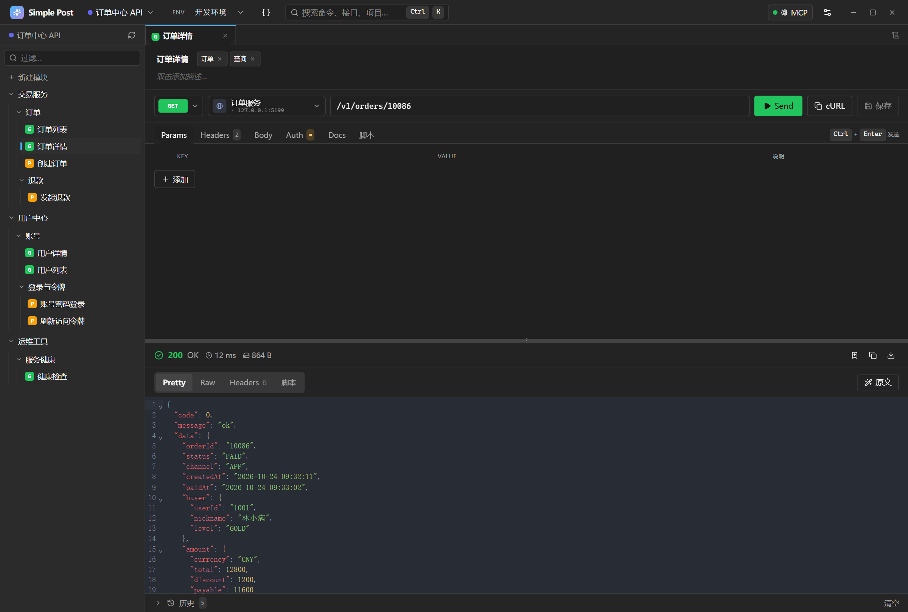
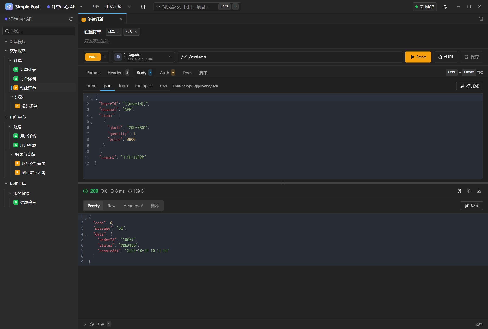
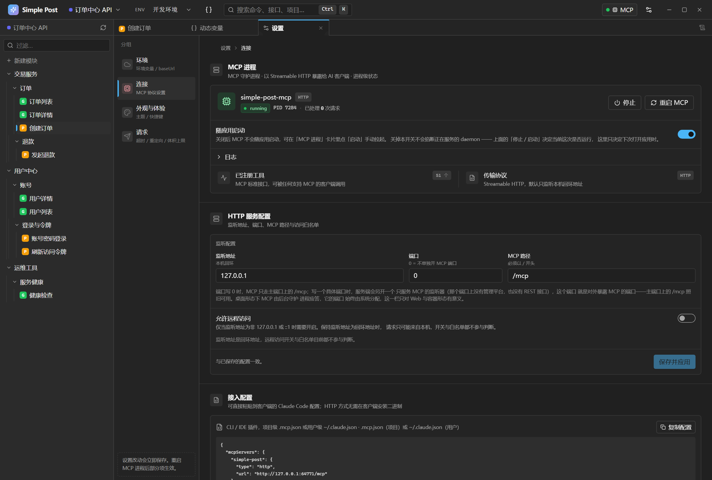
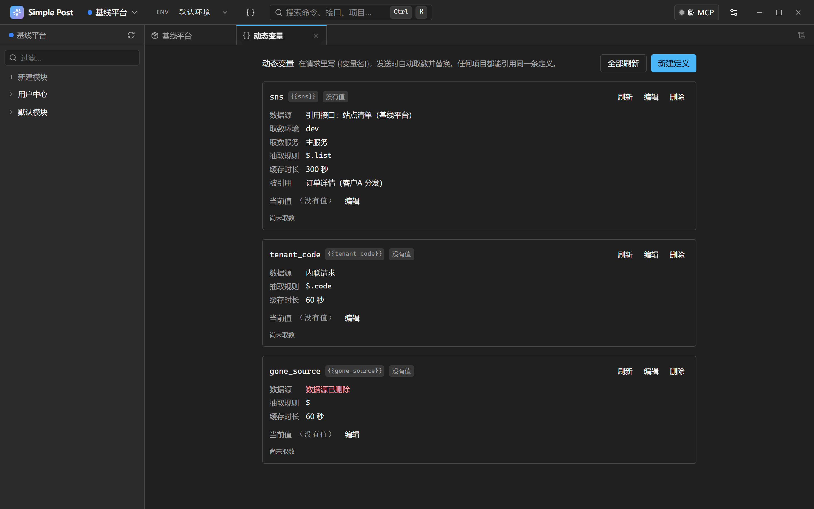
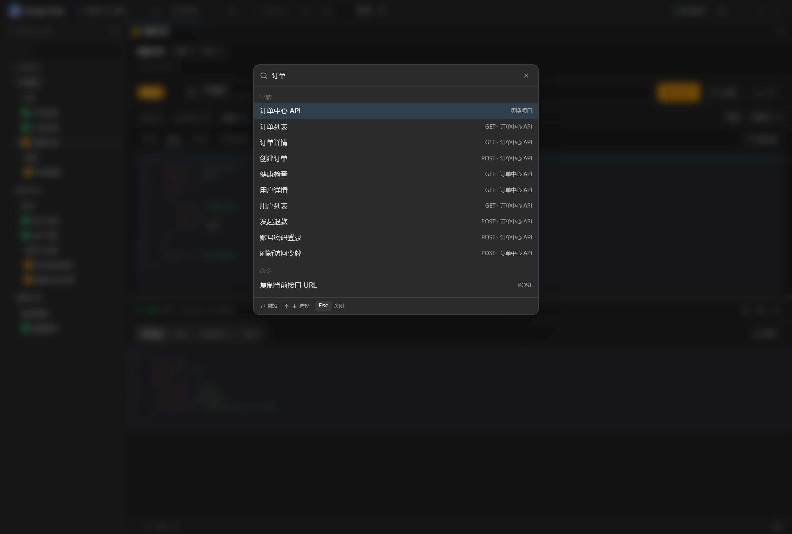
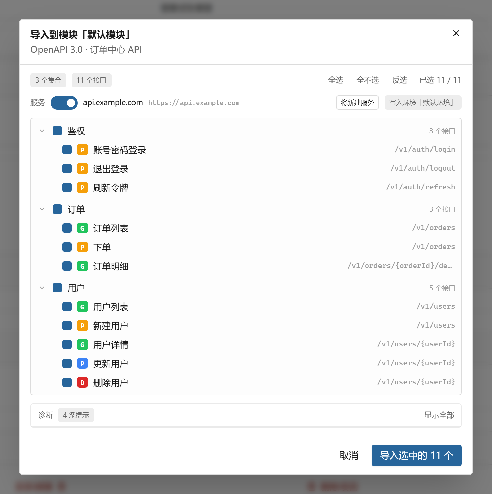
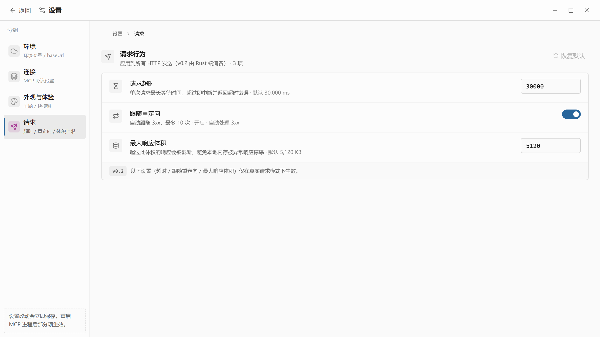

<div align="center">


# Simple Post

**本地优先的桌面 API 调试工具，同时是一个 MCP Server**

Claude Desktop、Cursor、Cline 等 AI 客户端可以直接读取并改写这里的接口定义，读到的就是用户正在维护的那份数据。

[](https://github.com/Nnyjk/simple-post/releases)
[](https://github.com/Nnyjk/simple-post/actions/workflows/ci.yml)
[](#)
[](#mcp-server)
[](LICENSE)

</div>

---

<div align="center">



<sub>工作区：左侧是接口树，中间是请求编辑器，下方是响应视图。截图中的接口是 `GET /v1/orders/10086`，响应由本地服务返回。</sub>

</div>

## 这是什么

Simple Post 是一个 Windows 10/11 上的桌面 API 调试工具。接口树、请求构造、响应查看都在同一个应用里完成，业务数据保存在本机的 SQLite 文件中，不依赖任何 SaaS 后端。

与其他 API 客户端的主要差别是：Simple Post 内置一个 MCP Server。外部 AI 客户端通过 52 个 MCP 工具读取和修改接口定义、环境变量与服务地址，也可以直接发起请求。AI 读到的是用户正在维护的那份数据，而不是从文档里推测出来的结构。

## 界面

<table>
<tr>
<td width="50%"><br /><sub><b>请求体</b>：载荷区与 Schema 区各管一件事，载荷是这一次发出的内容，Schema 是文档里的参数定义。</sub></td>
<td width="50%"><br /><sub><b>连接</b>：MCP 进程的运行状态、已注册工具数量，以及可直接粘贴给客户端的接入配置。</sub></td>
</tr>
<tr>
<td width="50%"><br /><sub><b>动态变量</b>：定义是全局的，一处声明任何项目都能引用。面板显示数据源、取数环境与服务，以及当前值。</sub></td>
<td width="50%"><br /><sub><b>命令面板</b>：<code>Ctrl+K</code> 打开，跨项目、模块、集合、接口搜索。</sub></td>
</tr>
<tr>
<td width="50%"><br /><sub><b>导入</b>：先预览将要写入的树，再逐项勾选。</sub></td>
<td width="50%"><br /><sub><b>请求设置</b>：超时、跟随重定向、最大响应体积，三个旋钮对桌面端与 MCP 端同时生效。</sub></td>
</tr>
</table>

## 核心能力

### 接口树：模块 → 集合 → 接口，集合可以继续嵌套集合

资源的层级是 Project → Module → Collection → Endpoint。集合下面还能建集合，嵌套深度不设上限，界面的面包屑按真实深度逐级显示。

模块、集合、接口存在同一张 `nodes` 表里，用 `type` 区分，父子关系由 `parent_id` 表达。层级规则是强制执行的契约：模块只能放在顶层，接口可以挂在集合下、也可以直接挂在模块下（单个接口不需要先建一个一次性集合），集合可以挂在模块或另一个集合下。SQLite 触发器与应用层检查同时校验，拖拽落点遵守同一张矩阵。

### 服务地址按「环境 × 模块 × 服务」逐格隔离

服务清单是项目级的：整个项目只有一份清单，每个模块都能看到清单里的全部服务，也不会出现两个同名服务。每个服务的地址是一个独立的问题：`环境 × 模块 × 服务` 三个维度各自一格。

某一格没有填写，表示该模块在此环境下没有这个服务的地址，并且不继承任何值——既不继承项目默认服务，也不继承别的模块。地址存放在 `environments.module_base_urls_json` 里，结构是 `服务 id → 模块 id → URL`。

### 请求体分两栏：载荷与定义

请求体的 `content` 是这一次发出的载荷，`schema` 是文档里这份接口接受什么参数的定义（JSON Schema，只用于文档与 OpenAPI 导出，从不参与发送）。两者都是 JSON 对象，形状接近，所以界面给它们两个编辑器：`content` 一个，`schema` 一个折叠在下面。

MCP 侧的工具描述写明哪个字段放什么，并且设了一道门：载荷看起来是一份 Schema、而 `schema` 还空着时，`endpoint_create` 与 `endpoint_update` 都会拒绝这次提交。

### 请求脚本运行在嵌入式 QuickJS 沙箱里

接口与集合都可以配置前置脚本（pre-request）与测试脚本（test）。前置脚本在变量替换之后、请求发出之前运行，可以改写 URL、请求头与请求体，发出去的就是改写后的那个请求。测试脚本在响应返回后运行，可以断言并写回环境变量。

脚本运行在嵌入式 QuickJS（`rquickjs`）里，宿主能力只有一段固定 JavaScript 前导给出的那几样：`pm.request`、`pm.environment`、`pm.response`、`pm.test`、`pm.expect`、`console.log`。脚本访问不到文件系统、网络与进程，因为代码里不存在通向它们的路径。硬限额是每阶段 1000 ms 墙钟、32 MB 内存、256 KB 栈；超时真的会打断死循环。

脚本失败不影响这次请求的成败：失败脚本的改动被丢弃，失败原因单独显示在响应区的「脚本」页里。

### 动态变量：声明一次，发送时自动取数

一条动态变量等于「变量名 → 数据源 → 抽取规则 → 缓存时长」。请求体里写 `{{sns}}`，发送时程序自动取数、抽取、缓存并替换。

定义是全局的：基线平台与各个客户分发项目共用同一份基础数据源，一处声明，任何项目的接口都能引用它，变量名在整个工作区里唯一。取数用哪个环境与服务由定义自己决定——环境点名了就用它，没点名就用数据源接口所属项目的第一个可用环境；服务点名了就用它，没点名就用那个项目的默认服务（★）。

数据源有两种形态：引用接口树里的一个接口（复用它的基础地址、鉴权与前置脚本），或者一份内联请求。缓存按「定义 × 环境」存放在 SQLite 里，因此桌面应用、`serve-web` 与 MCP 守护进程三个进程看到的是同一份值。取数失败不影响这次请求的成败：变量按缺失处理，`{{sns}}` 原样留在请求体里，失败原因在面板与响应区里说明。

### 导入与导出

| 方向 | 格式 | 说明 |
| --- | --- | --- |
| 导入 | Postman v2.1 集合 | 文件夹变成集合，条目变成接口，条目上的 `event[]` 落成对应接口或集合的脚本。 |
| 导入 | OpenAPI 3.0 文档 | 按 `tags[0]` 分成集合，路径变成接口；没有 tag 的接口归进以文档名命名的集合。全部写进导入时选定的模块。 |
| 导出 | OpenAPI 3.0 文档 | 按勾选的集合与接口生成文档，可选 JSON 或 YAML。 |

导入与导出都是先预览、再写入。预览对话框列出将要写入的树，用户逐项勾选，并能看到转换过程中产生的诊断。

### MCP Server

52 个 MCP 工具，覆盖项目、模块、集合、接口、服务地址、环境变量、动态变量与请求解析。AI 客户端能列项目、搜接口、查环境变量、发起调用，也能创建与改写接口定义——不是只读。

工具是按「一次调用建好一个接口」设计的，而不只是 CRUD：

- **一份规格一次落库。** `spec_upsert` 收一份声明式规格：模块、集合路径、环境、服务与端点。它在一个事务里把这一整份写进库里——缺的模块与集合逐级建出来，缺的环境与服务按名字建出来，URL 写进（环境 × 服务 × 模块）那一格。建一份接口规范不必再按「先查一遍、再建一下」串七八次调用。
- **同一份规格有三个入口。** MCP 工具 `spec_upsert`、REST 路由 `POST /api/spec/upsert` 与桌面端命令 `spec_upsert` 落的是同一份规格，落库逻辑只有一份实现。REST 请求体就是那份规格本身，不带外层包装；字段名的两种拼写（`project_id` 与 `projectId`）都收，因此同一份规格可以在 AI 客户端与 HTTP 调用方之间原样搬运。
- **按路径寻址。** `collection_create` 与 `endpoint_create` 接受 `collection_path`（如 `订单/明细`），路径上缺的集合会被逐级建出来，已有的同名集合直接复用。建一个接口不必先查一遍树。
- **创建是幂等的。** 所有 `*_create` 工具接受 `if_exists`（`reuse` / `error` / `duplicate`，默认 `reuse`）。重复调用同一个接口定义不会造出第二份。`spec_upsert` 另有一档 `update`：它覆盖规格里点名的字段，没点名的字段保持原样。
- **一次调用写全。** `endpoint_create` 一次收下 method、url、参数、请求头、请求体的载荷与定义、鉴权、前置脚本与测试脚本，不需要再补一次 `endpoint_update`。
- **写完就告诉你还缺什么。** 写工具的响应里带 `missing`：base URL 那一格没有值，或者环境里没有它引用的变量，都会点名说出来。agent 不必先发一次请求、看报错、再回头补。
- **一份可按需读取的指南。** MCP 的 `resources/list` 与 `resources/read` 提供 `simple-post://spec-authoring`，里面是「建一个接口规范」的完整调用顺序与参数形状。客户端在动手前读一次即可，不必把它塞进每一条工具描述里。

写操作的授权要同时通过两道检查，任何一道缺失都是拒绝而不是放行：

1. **全局能力策略**：用户在设置里选择的 `read_only` / `safe_write` / `full_access` 决定可见的工具集合。能力等级是全序 `Read < Create < Update < Delete < Send`，其中 `Send`（发起出站请求）只有 `full_access` 才覆盖——允许写入不等于允许发请求。
2. **项目权限**：按项目在 `permissions` 表里授权，默认 `ReadCall`。没有分类的工具按最严格的一档处理。

两道检查的关系是「与」，取更严格的一项。默认策略是 `read_only`，AI 写入默认关闭，需要用户在设置里显式调整。

## 三种分发形态

同一套 Rust 核心，三种入口：

| 形态 | 命令 | 说明 |
| --- | --- | --- |
| 桌面应用 | `simple-post` | Tauri 图形界面，`tauri build` 产出 NSIS / dmg / deb 安装包。 |
| 无头 Web | `simple-post serve-web` | REST 接口 + 单页应用，默认 4173 端口，可挂反向代理，可放进容器。 |
| MCP 桥接 | `simple-post-mcp` | 独立二进制，把标准输入输出上的 JSON-RPC 转发给运行中的 `serve-web`，供 AI 客户端以 stdio 方式挂载。 |

`simple-post-server` 是另一条**不链接 Tauri** 的构建路径，产出物具备 `serve-web` 与 `mcp` 两个子命令，但不携带 GUI 运行时。容器镜像构建的就是它，因此镜像里没有 GTK、WebKit 与 X11。

MCP 桥接二进制只以编译产物的形式发布（release 产物或 `cargo install simple-post-mcp`），没有 npm 包。`simple-post mcp-proxy` 这个子命令会提示改用独立二进制并以退出码 2 结束。

## 快速开始

### 本地开发

需要 Node.js 20–22（`package.json` 的 `engines` 声明为 `>=20 <23`）与 Rust 1.87 及以上。

```bash
npm install
npm run dev            # Vite 开发服务器 → http://127.0.0.1:5173
npm run dev:split      # 同时启动 Vite 与 cargo run -- serve-web（4173），前后端联调用这个
npm run build          # tsc -b && vite build → dist/
npm run check          # 本地门禁：Prettier → ESLint → tsc → 单测 → OpenAPI lint → cargo fmt → clippy
```

Rust 侧：

```bash
cargo build --release                      # 桌面应用与全部子命令
cargo build --release -p simple-post-server # 仅无头服务（容器用）
cargo test --workspace                     # 全部 Rust 测试
```

`npm run check` 与 CI 执行的是同一套检查。提交前本地跑一次即可。

### 容器

```bash
docker build -t simple-post:local .
docker compose up -d          # → http://localhost:4173
```

镜像里只有 `simple-post-server`（不含 Tauri）、单页应用的静态产物与一个数据目录。SQLite 使用 `rusqlite` 的 `bundled` 静态编译，TLS 使用 rustls 内置的根证书集，因此镜像不安装 GTK、WebKit、X11 与 OpenSSL。镜像内单页应用在 `/app/spa`，数据在 `/data`。

| 变量 | 默认值 | 说明 |
| --- | --- | --- |
| `SP_WEB_PASSWORD` | 空 | 映射到 `SIMPLE_POST_WEB_PASSWORD`：`/api/*` 与 `/mcp` 的 Bearer 口令。留空即完全不鉴权。 |
| `SP_WEB_BIND` | `4173` | 宿主机映射的端口，容器内固定为 4173。 |
| `SP_RUST_LOG` | `info` | 映射到 `RUST_LOG`，是 tracing 的日志过滤级别。 |
| `SIMPLE_POST_PUBLIC_BASE_PATH` | 空 | 反向代理前缀，必须以 `/` 开头。 |
| `SIMPLE_POST_BLOCK_PRIVATE_NET` | `0` | 置为 `1` 后，`/api/http/send` 拒绝回环、私网与链路本地地址（含云厂商 metadata）。 |

`SP_*` 是 compose 的插值变量名，写在 `.env` 里（见 `.env.example`），由 compose 文件转成程序认识的 `SIMPLE_POST_*`。

Swarm 部署时有两个不要改动的约束：

- `replicas: 1`——数据落在一个 WAL 模式的 SQLite 文件里，WAL 依赖同机共享内存，多写进程会互相 `SQLITE_BUSY`，`mcp.port` 也只能有一个属主。
- `placement`——命名卷是 `local` 驱动，只存在于一个节点。`replicas: 1` 挡不住这个问题：更新后重新调度会把任务放到别的节点，Docker 在那里建一个空卷，服务照样健康起来，数据却没有迁移过去。把 `placement` 注释掉会让部署直接失败，这正是期望的失败方式。

镜像 tag 写 `${SP_IMAGE:-simple-post:local}`，因为 Swarm 按 spec 里写的名字在每个节点上拉镜像，多节点部署时必须用 `SP_IMAGE` 指向真正推送上去的 tag。

### 让 AI 客户端连上

设置面板的「连接 → 接入配置」会生成一份可以直接粘贴的片段，形如：

```json
{
  "mcpServers": {
    "simple-post": {
      "type": "http",
      "url": "http://127.0.0.1:<daemon 端口>/mcp"
    }
  }
}
```

客户端不安装任何东西。客户端所在机器不能运行 `simple-post-mcp` 时，也可以直接指向 `simple-post serve-web` 暴露的 `POST /mcp`，传输的是同一套 JSON-RPC。

不要把 daemon 端口写死在客户端配置里。`simple-post mcp` 默认使用 `--port=0`，端口由操作系统分配，每次重启都会变化，写死的地址会在下次重启时失效。

## 部署到服务器

### 无头 Web

```bash
./target/release/simple-post-server serve-web --bind 0.0.0.0 --port 4173
curl http://localhost:4173/api/healthz
# {"status":"ok","version":"…","shape":"server"}
```

MCP 客户端连接 `http://host:4173/mcp`，并带上 `Authorization: Bearer <口令>`。

同一套 REST 接口也开放给脚本与自动化工具，其中 `POST /api/spec/upsert` 一次调用落一份完整的接口规格（模块、集合路径、环境、服务与端点），与 MCP 工具 `spec_upsert` 落的是同一份东西。

需要给 MCP 分配独立端口时，在设置面板的「连接 → HTTP 服务配置」里把「端口」填成一个具体数字（例如 4174）。服务端会另外开一个只提供 MCP 的监听器，那个端口上只有 `/mcp`、`/mcp/healthz` 与 `/mcp/tools`，没有 REST 接口与单页应用。端口填 0 时不单独开端口，MCP 只走主端口。改动需要重启服务才生效。

独立端口是新增的一条入口，主端口上的 `/mcp` 照旧可用。两者的差别在于：独立端口按 MCP 自己的 Host 与 Origin 白名单校验，主端口上的 `/mcp` 不做 Host 校验，只受 Bearer 口令约束。

这个端口是唯一对外暴露 MCP 的位置，部署侧发布它时，发布的目标端口必须与设置里填写的数字一致。

数据保存在 `SIMPLE_POST_DATA_DIR`（未设置时为 `%APPDATA%/simple-post`），把该目录挂到持久卷即可。SQLite 运行在 WAL 模式下，可以安全落盘。

### 反向代理

要让服务挂在 `https://host/sp/` 下，用 `--public-base-path /sp`（或 `SIMPLE_POST_PUBLIC_BASE_PATH=/sp`）启动，并且原样转发，不要剥离前缀——前缀由服务端自己处理。

nginx：

```nginx
location /sp/ {
    # 结尾不带 URI 部分 = 原样转发；写成 /sp/ 或用 rewrite strip 都会把前缀剥掉
    proxy_pass http://127.0.0.1:4173;
    proxy_set_header Host $host;
    proxy_set_header X-Forwarded-For $proxy_add_x_forwarded_for;
    proxy_set_header X-Forwarded-Proto $scheme;
}
```

Caddy：

```
sp.example.com {
    reverse_proxy 127.0.0.1:4173   # 保留原始路径；不要用 handle_path（它会剥掉前缀）
}
```

前缀只由一处处理。服务端会把整个路由（`/api/*`、`/mcp` 与三个健康探针）一起放进 `/sp` 下，并按实际前缀改写单页应用外壳里的资源引用。nginx 若再剥一次，两边就对不上。设置前缀后健康检查也移到 `/sp/healthz`，探针要跟着改。

### 安全约束

改配置前先读一遍这几条。

- **`SIMPLE_POST_WEB_PASSWORD` 必须设置。** 口令为空时鉴权中间件不生效，`/api/*` 与 `/mcp` 对所有能连到该端口的调用方开放。容器监听 `0.0.0.0`，因此这个口令是唯一的访问控制。
- 健康检查 `/api/healthz`、`/mcp/healthz`、`/healthz` 始终免认证，方便探针使用；`/assets/*` 与单页应用外壳同样免认证——浏览器无法给 `<script type="module">` 附加 `Authorization` 头，对它们鉴权会让带口令的部署无法打开页面。
- **两条出站通道的权限不同**：
  - `POST /api/nodes/:id/send`（界面的 Send 按钮走这条）只接受接口 id 与相对路径，基础地址、路径、`{{var}}` 替换与鉴权全部由服务端按数据库里的配置组装。浏览器无法指定目标地址，传入绝对 URL 会被 400 拒绝，因此这条通道没有 SSRF 面。
  - `POST /api/http/send` 是原始 URL 通道，调用方可以指定任意地址（仅允许 `http` 与 `https`）。默认不拦截私网地址——桌面端用户经常要访问 `localhost:3000`，默认拦截会破坏主要用途。公网或共享部署请设置 `SIMPLE_POST_BLOCK_PRIVATE_NET=1`，额外拒绝回环、私网、链路本地（含云厂商 metadata `169.254.169.254`）与 CGNAT 网段。

## 技术结构

前端（React 19 + Vite 8 + Zustand 5 + Tailwind 4）通过 Tauri IPC 或 `fetch('/api/…')` 两条等价通道调用同一套 Rust 命令。Rust 侧是一个 Cargo workspace，SQLite（`rusqlite`，WAL 模式）是唯一的存储。

| 部件 | 路径 | 职责 |
| --- | --- | --- |
| Tauri 外壳与 CLI | `src-tauri/` | 桌面图形界面、`#[tauri::command]` 接口、clap 子命令分发。 |
| 服务宿主 | `crates/simple-post-server/` | `serve-web` 的 REST 与单页应用、daemon 进程管理、端口登记、Bearer 鉴权、传输层 DTO。 |
| 核心库 | `crates/simple-post-core/` | 领域模型、SQLite 数据访问、HTTP 执行器、权限、MCP 指标、错误类型。不依赖 Tauri 与 axum。 |
| MCP 服务 | `crates/simple-post-mcp/` | JSON-RPC 2.0 派发（52 个工具）、axum HTTP daemon、标准输入输出桥接。 |
| 导入导出 | `crates/simple-post-interchange/` | 外来格式与标准格式之间的转换层，负责 Postman 与 OpenAPI 的解析和生成。 |
| 前端 | `src/` | React、Zustand、Tailwind、CodeMirror 6。 |

依赖方向是单向的：`simple-post`（Tauri）→ `simple-post-server` → `simple-post-core`。`src-tauri` 无条件链接 `tauri`，会把 GTK 与 WebKit 拖进 Linux 构建，服务宿主因此单独拆成一个 crate。

## 已实现

**数据与资源树**

- Project → Module → Collection（可递归，深度不限）→ Endpoint，以及 Environment 与 Response（`crates/simple-post-core/src/domain.rs`）
- 整棵树存在一张 `nodes` 表里，用 `type` 区分；所属项目以 `root_id` 写在每一行上，一次索引读即可回答「这条记录属于哪个项目」（`crates/simple-post-core/src/db/schema.sql`）
- 接口的请求配置（method、url、auth、body、headers、params、tags）单独放在 `endpoint_details` 表里，这些字段对模块与集合没有意义（`db/endpoint_details.rs`）
- 层级合法性由 SQLite 触发器与应用层检查同时强制（`ResourceNodeType::may_under`、`db::nodes::move_many`）
- 完整增删改查、复制接口、级联清理，以及模块、集合、接口的上下移排序（`db/nodes.rs`）
- 响应历史持久化在 SQLite 里，每个接口最多保留 10 条；响应体超过上限时记 `body_truncated`，查看器据此说明，而不是把半个文档当成完整内容显示（`db/response_history.rs`）

**桌面与界面**

- 项目与环境切换、全局搜索（`Ctrl+K`）、MCP 进程状态指示器、设置入口（`src/features/top-bar/`）
- 侧边树递归渲染集合层级、method 彩色徽标、双击改名、右键菜单、删除确认（`src/features/project-tree/`）
- 拖拽支持三种落点：集合正中间是移进该子树，上边缘与下边缘是同级前后插入（`src/lib/tree-index.ts`）
- 请求测试器提供 method、URL（`{{var}}` 高亮与变量选择浮层）、Params、Headers、Body、Auth、Docs、脚本六个标签页；CodeMirror 6 的 JSON 编辑器带实时校验，Markdown 分屏预览，鉴权支持 None、Bearer、Basic、API Key 与 OAuth 2.0（`src/features/http-tester/`）
- 复制为 cURL、保存接口定义（`src/lib/http-build.ts`）
- 响应区显示状态码、耗时与大小，提供 Pretty、Raw、Headers 三种视图，支持复制与下载，历史折叠条里的记录可以点击重放（`src/features/response-viewer/`）
- 命令面板跨项目、模块、集合、接口模糊搜索，并内置切换环境、切换主题、打开设置、新建项目、新建模块、复制当前接口 URL 等命令
- 主题支持 dark、light、system 三种，在 `<html>` 上切换 class，刷新后保留且没有白屏闪烁（`src/styles/globals.css`）

**设置**

- 服务（baseUrl）：项目级共享清单，每个模块在每个环境各填各的地址，表头按「模块 × 服务」逐格展开，空格即无地址、不继承
- 环境变量 `{{var}}` 实时编辑，随项目创建，可以重命名与删除
- MCP 进程状态：运行指示、daemon 上报的已注册工具列表、daemon 日志尾部（最近 500 行，可折叠）
- 主题、请求设置（超时、跟随重定向、最大响应体积）、快捷键速查（`src/features/settings/`）

**关于数据**

- 首次启动不写入任何演示数据，只创建数据库表，项目树是空的。`crates/simple-post-core/src/db/fixtures.json` 仅供 Rust 测试使用，只能通过 `#[cfg(test)] pub(crate) mod test_support` 访问，生产构建里不存在这个路径。
- 偏好设置（主题）保存在 localStorage，业务数据保存在 SQLite。

## 路线图

v0.1.x 已交付：Tauri 桌面应用、`serve-web` 无头 Web 与独立 MCP 二进制，三者共用一套 Rust 核心。勾选状态以对应 issue 的状态为准。

### v0.2

已全部交付。

- [x] 鉴权扩展：Bearer、Basic、API Key（含 apikey 的 header 与 query 注入）
- [x] 鉴权扩展：OAuth2 简化版（#2）
- [x] 响应历史持久化到 SQLite（#1）
- [x] MCP 进程可视化补齐：daemon 日志尾部（PID 与状态已实现）（#6）
- [x] 导入 Postman v2.1（#3）
- [x] 导入 OpenAPI 3.0 文档（#4）
- [x] 导出 OpenAPI 3.0（#5）
- [x] MCP 写工具：`endpoint_create`、`endpoint_update`、`endpoint_search`、`endpoint_delete`
- [x] 仓库治理：说明内容、CI 提速与镜像发布、协作规范、注释中文化（#23 #24 #25 #26）

### v0.3

- [ ] AI 文档生成（接口转 Markdown）（#9）
- [ ] AI 测试用例生成（schema 转测试）（#10）
- [x] 请求脚本（pre-request 与 test 脚本，沙箱隔离）（#7）
- [x] 动态变量（声明一次 → 取数 → 缓存 → 手动编辑）（#109）
- [ ] 集合批量运行与简易报告（#8）
- [ ] 团队协作（Git 同步 JSON 工作区，可选）（#11）

### v1.0

- [ ] WebSocket、SSE 与 GraphQL 协议支持（#12）
- [ ] Mock Server（从集合生成 mock 服务，支持故障注入）（#13）
- [ ] 性能压测（与开发期的 `npm run perf:bench` 基准区分）（#14）
- [ ] 插件系统：第三方 MCP 工具注册（须保住两道校验的 fail-closed 行为）（#15）

## 贡献

开发规范、架构约定与高风险点（数据库迁移、MCP 两道校验、双通道实现的五处协同）写在 [`AGENTS.md`](AGENTS.md) 里。协作流程见 [`.github/CONTRIBUTING.md`](.github/CONTRIBUTING.md)。

```bash
npm run check   # 提交前跑这一条即可覆盖全部本地门禁
```

MIT 许可。
