<div align="center">


# Simple Post

**本地优先的桌面 API 调试工具，同时是一个 MCP Server**

Claude Desktop、Cursor、Cline 等 AI 客户端可以直接读取并改写这里的接口定义，读到的就是用户正在维护的那份数据。

[](https://github.com/Nnyjk/simple-post/releases)
[](https://github.com/Nnyjk/simple-post/actions/workflows/ci.yml)
[](#)
[](#mcp-server)
[](LICENSE)

</div>

---

<div align="center">

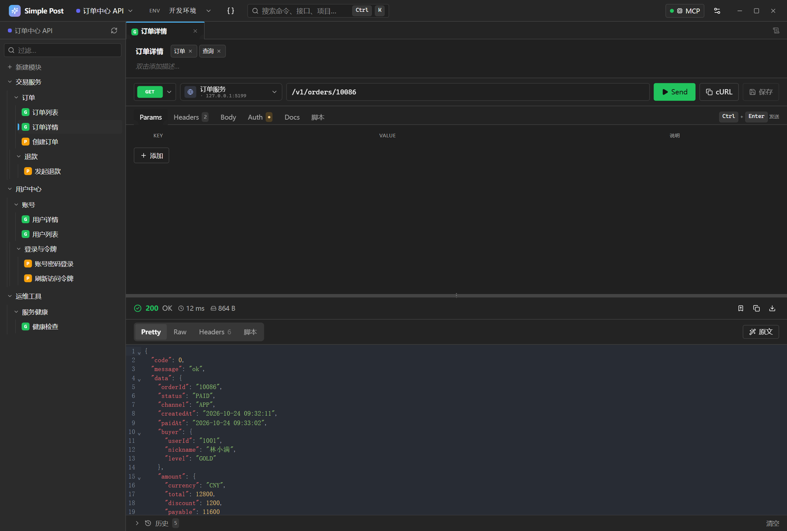

<sub>工作区：左侧是接口树，中间是请求编辑器，下方是响应区。响应区分左右两栏，左栏是这一次实际发出去的请求，右栏是收回来的响应。</sub>

</div>

## 这是什么

Simple Post 是一个 Windows 10/11 上的桌面 API 调试工具。接口树、请求构造与响应查看都在同一个应用里完成，业务数据保存在本机的 SQLite 文件中，不依赖任何 SaaS 后端。

它与其它 API 客户端的主要差别是内置了一个 MCP Server。外部 AI 客户端通过 48 个 MCP 工具读取并修改接口定义、环境变量与模块地址，也可以直接发起请求。AI 读到的就是用户正在维护的那份数据。

## 界面

<table>
<tr>
<td width="50%">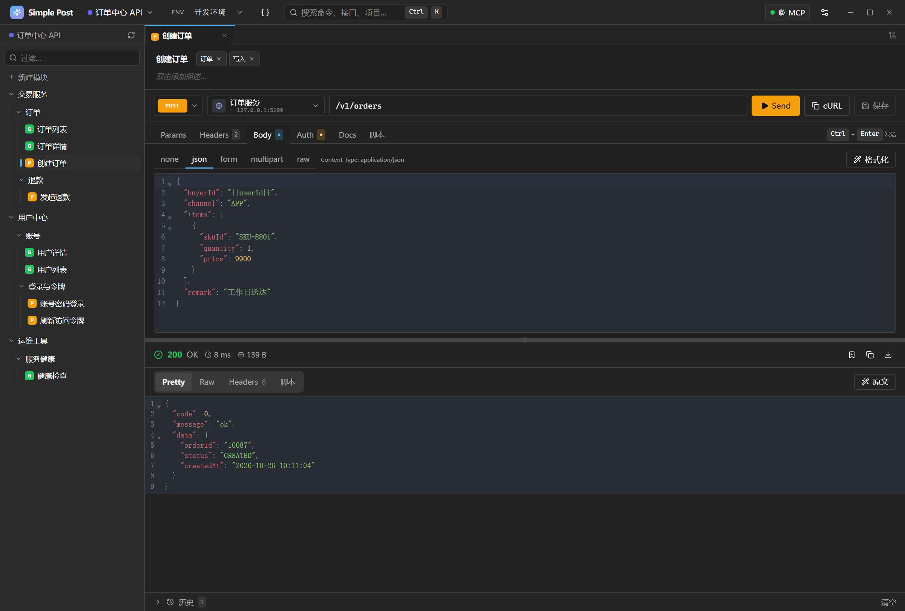<br /><sub><b>请求体</b>：左栏是这一次发出的载荷，右栏是文档里的参数定义。</sub></td>
<td width="50%">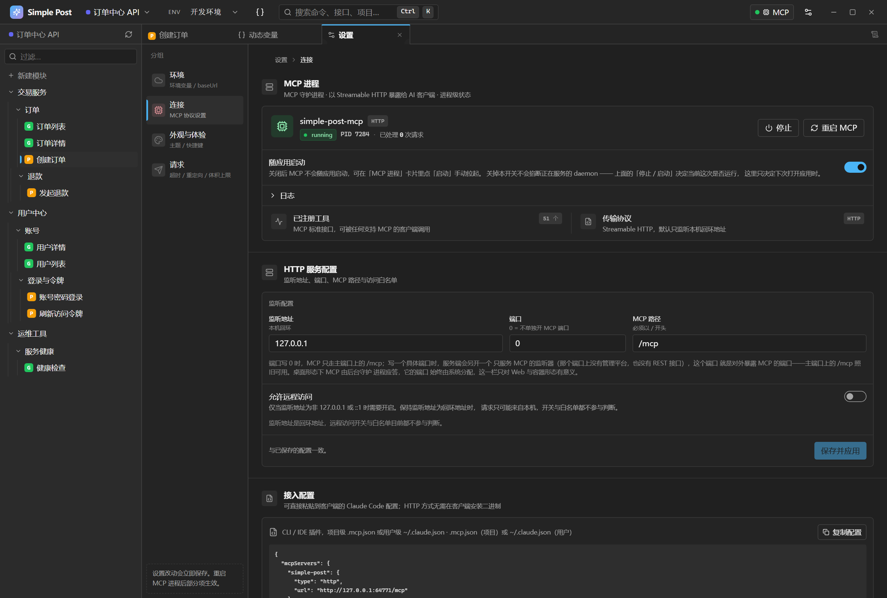<br /><sub><b>连接</b>：MCP 进程的运行状态、已注册工具数量与接入配置。</sub></td>
</tr>
<tr>
<td width="50%">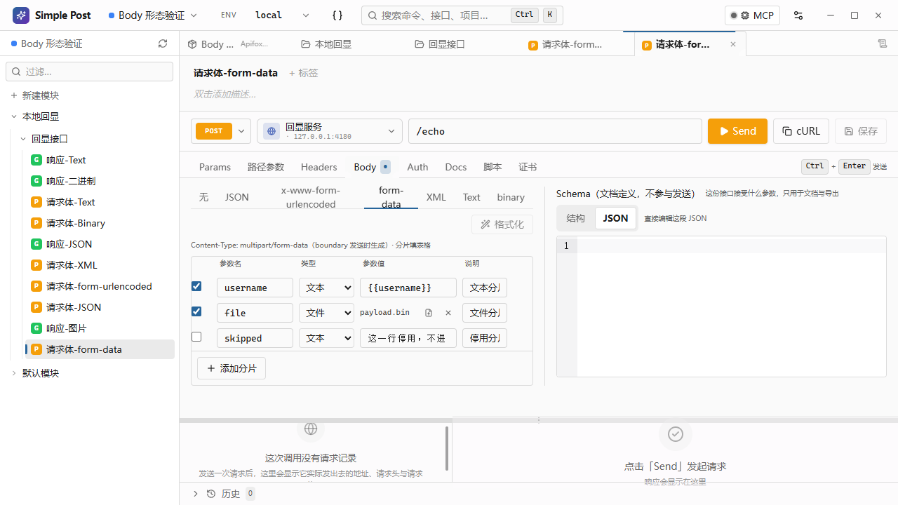<br /><sub><b>请求体形态</b>：七种形态各有自己的编辑器，form-data 的分片可以在文本与文件之间切换。</sub></td>
<td width="50%">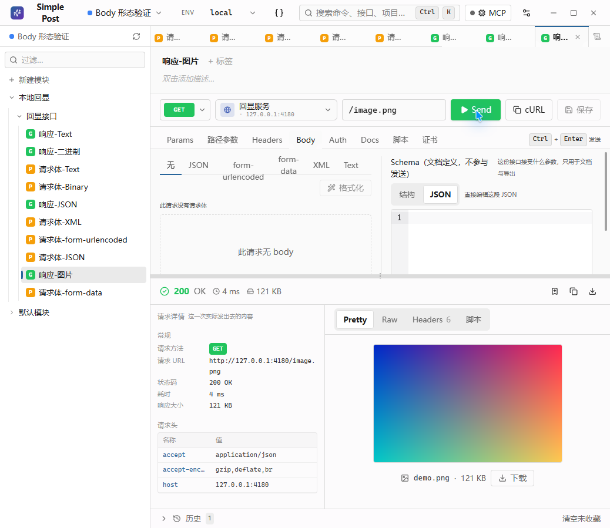<br /><sub><b>响应</b>：JSON 走 Pretty，文本走文本，图片给预览，二进制给下载卡片。</sub></td>
</tr>
<tr>
<td width="50%">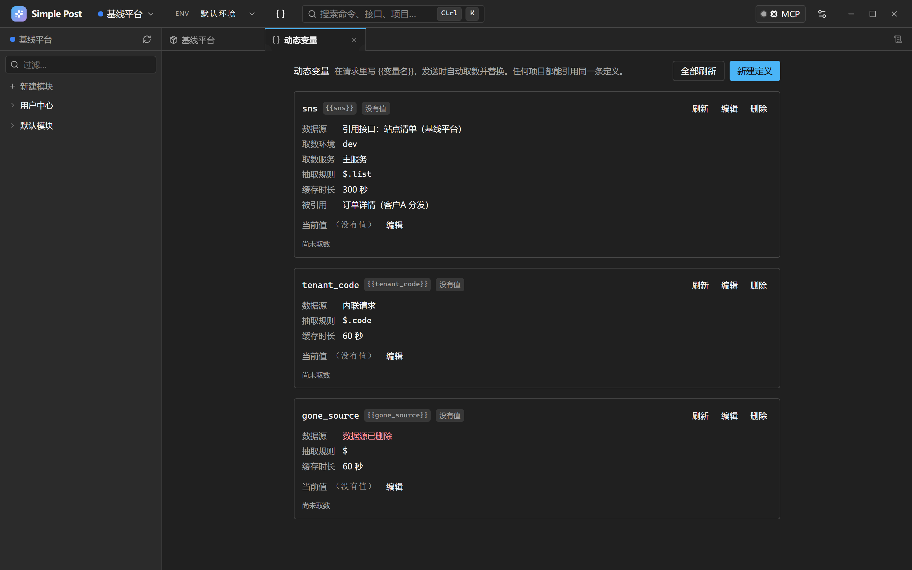<br /><sub><b>动态变量</b>：定义挂在项目里，变量名在项目内唯一。</sub></td>
<td width="50%">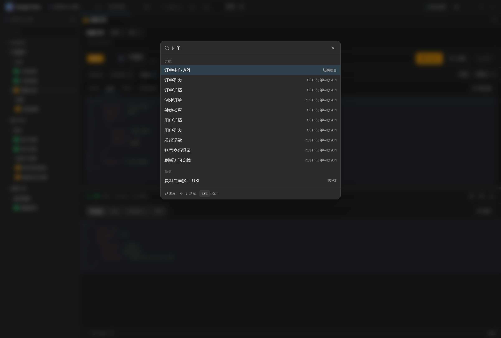<br /><sub><b>命令面板</b>：<code>Ctrl+K</code> 打开，跨项目、模块、集合、接口搜索。</sub></td>
</tr>
<tr>
<td width="50%">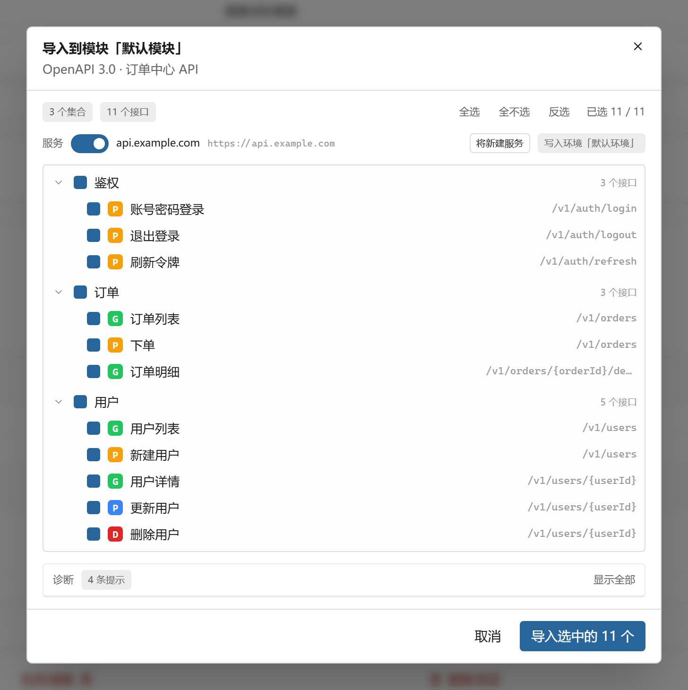<br /><sub><b>导入</b>：先预览将要写入的树，再逐项勾选。</sub></td>
<td width="50%">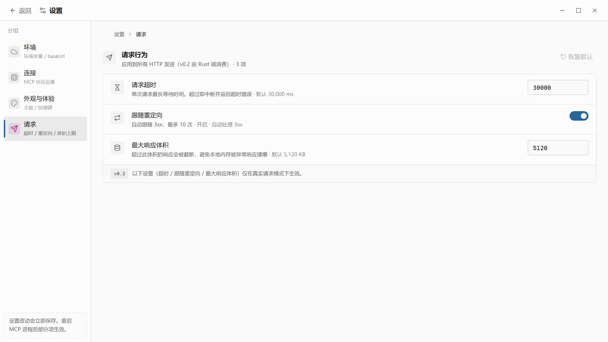<br /><sub><b>请求设置</b>：超时、跟随重定向、最大响应体积与 HTTPS 出站的全局默认。</sub></td>
</tr>
<tr>
<td width="50%">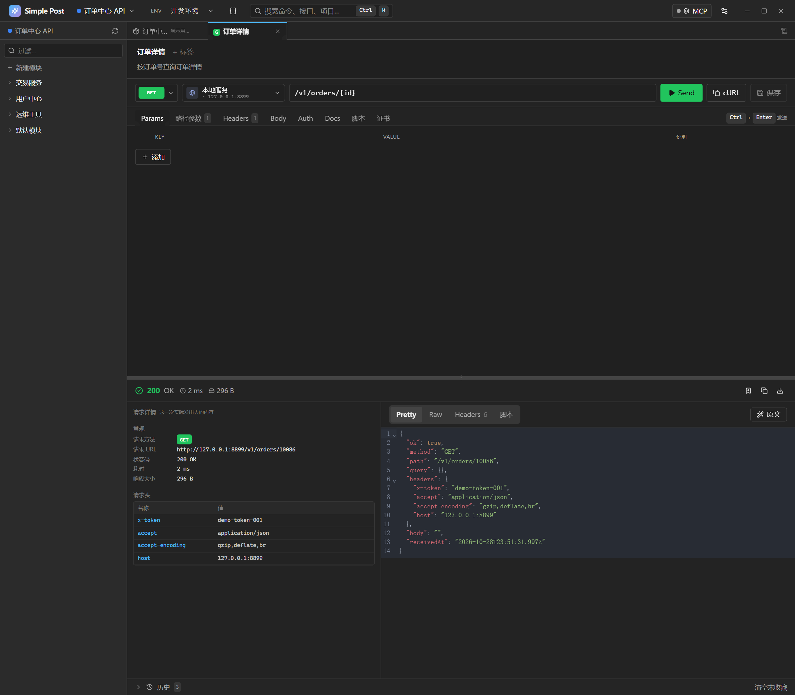<br /><sub><b>请求详情</b>：左栏画的是线上真正发出去的那一份，含传输层补齐的请求头。</sub></td>
<td width="50%">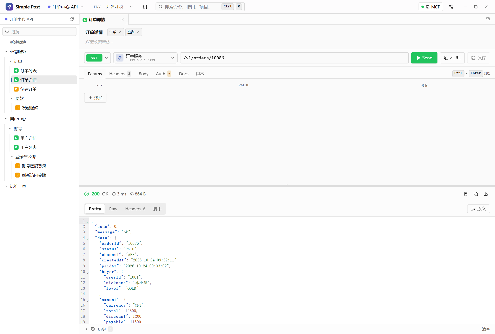<br /><sub><b>响应区</b>：左右两栏回答同一次调用的两面：服务端收到什么、回了什么。</sub></td>
</tr>
<tr>
<td width="50%">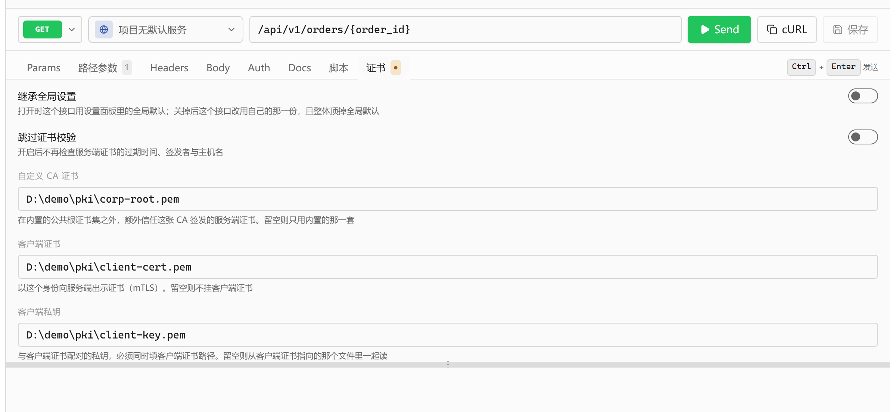<br /><sub><b>证书</b>：端点自己那份 HTTPS 出站设置，给了自己那份就整体顶掉全局默认。</sub></td>
<td width="50%">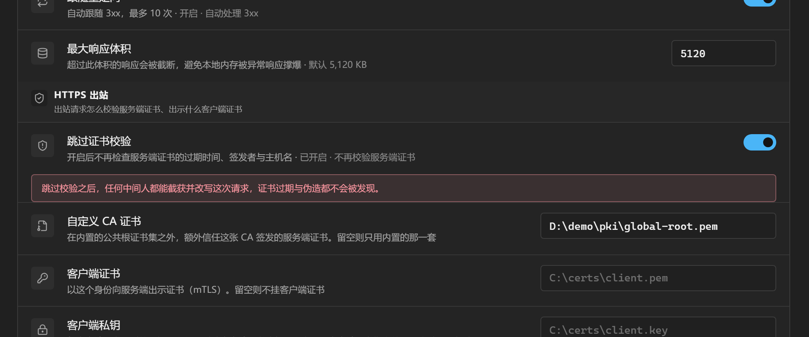<br /><sub><b>HTTPS 出站</b>：跳过校验、自定义 CA、客户端证书与私钥。</sub></td>
</tr>
</table>

## MCP Server

48 个 MCP 工具，覆盖项目、模块、集合、接口、模块地址、环境变量、动态变量与请求解析。AI 客户端能列项目、搜接口、查环境变量、发起调用，也能创建与改写接口定义。

工具按「一次调用建好一个接口」设计：

- `spec_upsert` 收一份声明式规格，在一个事务里把模块、集合路径、环境与端点整份写进库里。MCP 工具与 REST 路由 `POST /api/spec/upsert` 落的是同一份规格。
- `collection_create` 与 `endpoint_create` 接受 `collection_path`，路径上缺的集合会被逐级建出来，已有的同名集合直接复用。
- 所有 `*_create` 工具接受 `if_exists`（`reuse` / `error` / `duplicate`，默认 `reuse`），重复调用同一个接口定义不会造出第二份。
- 写工具的响应里带 `missing`：模块地址那一格没有值，或者环境里没有它引用的变量，都会点名说出来。

写操作的授权要同时通过两道检查，任何一道缺失都是拒绝而不是放行：

- **全局能力策略**：设置里的 `read_only` / `safe_write` / `full_access` 决定可见的工具集合。`Send`（发起出站请求）只有 `full_access` 才覆盖，允许写入不等于允许发请求。
- **项目权限**：按项目在 `permissions` 表里授权，默认 `ReadCall`，没有分类的工具按最严格的一档处理。

两道检查取更严格的一项。默认策略是 `read_only`，AI 写入默认关闭。

## 导入与导出

| 方向 | 格式 | 说明 |
| --- | --- | --- |
| 导入 | Postman v2.1 集合 | 文件夹变成集合，条目变成接口，条目上的 `event[]` 落成对应接口或集合的脚本。 |
| 导入 | OpenAPI 3.0 文档 | 按 `tags[0]` 分成集合，路径变成接口；没有 tag 的接口归进以文档名命名的集合。 |
| 导出 | OpenAPI 3.0 文档 | 按勾选的集合与接口生成文档，可选 JSON 或 YAML。 |

导入与导出都是先预览、再写入。预览对话框列出将要写入的树，用户逐项勾选，并能看到转换过程中产生的诊断。

## 快速开始

需要 Node.js 20–22 与 Rust 1.87 及以上。

```bash
npm install
npm run dev            # Vite 开发服务器 → http://127.0.0.1:5173
npm run dev:split      # 同时启动 Vite 与 serve-web（4173），前后端联调用这个
npm run check          # 本地门禁：Prettier → ESLint → tsc → 单测 → OpenAPI lint → cargo fmt → clippy
```

Rust 侧：`cargo build --release`（桌面应用与全部子命令）、`cargo build --release -p simple-post-server`（仅无头服务）、`cargo test --workspace`（全部测试）。`npm run check` 覆盖 CI 的两个 job，提交前本地跑一次即可。

桌面应用用 `npm run tauri:dev` 开发运行，用 `npm run tauri:build` 产出 NSIS / dmg / deb 安装包。

MCP 桥接二进制 `simple-post-mcp` 只以编译产物的形式发布：GitHub Release 上只有桌面安装包，crates.io 上也没有这个 crate，所以要在仓库根目录执行 `cargo install --path crates/simple-post-mcp`。没有 npm 包。

容器：

```bash
docker pull ghcr.io/nnyjk/simple-post:0.1.34
docker run -d --name simple-post -p 4173:4173 \
  -e SIMPLE_POST_WEB_PASSWORD=换成一句长随机口令 \
  -v simple-post-data:/data \
  ghcr.io/nnyjk/simple-post:0.1.34
```

浏览器访问 `http://localhost:4173/`；设了口令时第一次用 `http://localhost:4173/?token=<口令>` 打开，页面把口令存进浏览器的 localStorage，之后直接访问根路径即可。

MCP 的端点是守护进程自己的监听端口，主端口上不提供 MCP。设置面板的「连接 → 接入配置」会生成一份可以直接粘贴给客户端的片段：

```json
{
  "mcpServers": {
    "simple-post": {
      "type": "http",
      "url": "http://127.0.0.1:4174/mcp"
    }
  }
}
```

客户端不安装任何东西。客户端所在机器不能运行 `simple-post-mcp` 时，直接指向那个端口上的 `POST /mcp`，传输的是同一套 JSON-RPC。要让地址固定下来，就在「连接 → HTTP 服务配置」里把「端口」填成一个具体数字（例如 4174），保存后重启「MCP 进程」卡片里的守护进程。

## 部署

| 形态 | 适用场景 | 配置文件 | 启动方式 |
| --- | --- | --- | --- |
| Docker Compose | 单台机器，最常见的用法 | `docker/docker-compose.yml` | `docker compose --project-directory . -f docker/docker-compose.yml up -d` |
| Swarm 栈（命令行） | 多节点集群 | `docker/docker-swarm.yml` | `docker stack deploy -c docker/docker-swarm.yml simple-post` |
| Swarm 栈（Portainer） | 用 Portainer 图形界面管理集群 | `docker/docker-portainer.yml` | Portainer → Stacks → Add stack |
| 无头 Web（不用容器） | 已有 Rust 环境，直接跑二进制 | 无 | `simple-post-server serve-web --bind 0.0.0.0 --port 4173` |

镜像里只有 `simple-post-server`、单页应用的静态产物与一个数据目录。SQLite 使用 `rusqlite` 的 `bundled` 静态编译，TLS 使用 rustls 内置的根证书集，因此镜像不安装 GTK、WebKit、X11 与 OpenSSL。单页应用在 `/app/spa`，数据在 `/data`。

compose 相关命令都在仓库根执行。`--project-directory .` 不能省：compose 文件在 `docker/` 下，不带它时 Compose 会把 `docker/` 当成项目目录，于是读不到根目录的 `.env`，项目名也从 `simple-post` 变成 `docker`，数据卷跟着改名成 `docker_simple-post-data`（已有的卷就“消失”了）。

镜像地址是 `ghcr.io/nnyjk/simple-post`，只提供 linux/amd64，每个 `v*` 标签发布一次。常用标签：`0.1.34`（具体版本）、`0.1`（次版本）、`latest`（最新正式版）。

### Docker Compose 部署

准备 `.env`：

```bash
cp .env.example .env
```

至少把 `SP_WEB_PASSWORD` 改成一句长随机口令。不设置它时 `/api/*` 与 `/mcp` 对所有能连到该端口的调用方开放。镜像来源二选一：用发布镜像就在 `.env` 里写 `SP_IMAGE=ghcr.io/nnyjk/simple-post:0.1.34`；本地构建就执行 `docker build -f docker/Dockerfile -t simple-post:local .`，`SP_IMAGE` 留空即可。

启动与验证：

```bash
docker compose --project-directory . -f docker/docker-compose.yml up -d
docker compose --project-directory . -f docker/docker-compose.yml ps        # STATUS 应为 running / healthy
docker compose --project-directory . -f docker/docker-compose.yml logs -f simple-post
curl http://localhost:4173/api/healthz
# {"status":"ok","version":"…","shape":"server"}
```

打开页面：浏览器访问 `http://<宿主地址>:4173/`。设了口令时第一次用 `http://<宿主地址>:4173/?token=<口令>` 打开，页面把口令写进浏览器的 localStorage 并删掉地址栏里的查询参数，之后直接访问根路径即可。

发布 MCP 端口（三步）：在应用里打开「设置 → 连接 → HTTP 服务配置」，把「端口」填成 4174，把「监听地址」填成 `0.0.0.0`，按需打开「允许远程访问」并把访问用的域名或 IP 填进 Host 白名单，保存后点「MCP 进程 → 重启 MCP」；在 `docker/docker-compose.yml` 里取消注释 MCP 那段端口映射（`target: 4174`）；最后 `docker compose --project-directory . -f docker/docker-compose.yml up -d` 重建容器。端口、监听地址与两张白名单都在守护进程启动时读进命令行，不重启不生效。

配置项对照：

| `.env` 里的名字 | 程序读的名字 | 默认值 | 说明 |
| --- | --- | --- | --- |
| `SP_WEB_PASSWORD` | `SIMPLE_POST_WEB_PASSWORD` | 空 | `/api/*` 与 MCP 守护进程那个端口的 Bearer 口令。不设置即完全不鉴权。 |
| `SP_WEB_BIND` | 无 | `4173` | 宿主机映射的端口，容器内固定为 4173。 |
| `SP_IMAGE` | 无 | `simple-post:local` | 镜像名与标签。 |
| `SP_RUST_LOG` | `RUST_LOG` | `info` | tracing 的日志过滤级别。 |
| `SP_UPDATE_COMMAND` | `SIMPLE_POST_UPDATE_COMMAND` | 空 | 更新对话框「立即执行更新」执行的那条命令。留空即不可就地更新；要与 `SP_WEB_PASSWORD`（口令模式）同时成立才生效。命令由容器内的 bash 执行，只能用 bash 与 coreutils 的能力。 |
| `SP_PUBLIC_BASE_PATH` | `SIMPLE_POST_PUBLIC_BASE_PATH` | 空 | 反向代理前缀，必须以 `/` 开头。 |
| 无 | `SIMPLE_POST_BLOCK_PRIVATE_NET` | `0` | 置为 `1` 后，`/api/http/send` 拒绝回环、私网与链路本地地址（含云厂商 metadata）。这一项没有对应的 `SP_*` 变量，要在 compose 的 `environment` 里直接写。 |

`SP_PUBLIC_BASE_PATH` 在两个 compose 文件里都是注释掉的状态，只写进 `.env` 不生效，还要自己把那两行打开。

日常运维：

| 动作 | 命令 |
| --- | --- |
| 看日志 | `docker compose --project-directory . -f docker/docker-compose.yml logs -f simple-post` |
| 重启服务 | `docker compose --project-directory . -f docker/docker-compose.yml restart simple-post` |
| 停止并保留数据卷 | `docker compose --project-directory . -f docker/docker-compose.yml down` |
| 停止并删除数据卷 | `docker compose --project-directory . -f docker/docker-compose.yml down -v`（数据一并删除，不可恢复） |
| 升级 | 改 `.env` 里的 `SP_IMAGE` 版本号，再执行 `docker compose --project-directory . -f docker/docker-compose.yml pull && docker compose --project-directory . -f docker/docker-compose.yml up -d`。数据在卷里，升级不影响数据。 |

备份与恢复：SQLite 库运行在 WAL 模式，运行时直接复制文件可能拿到不完整的事务，所以先停服再打包卷。卷的实际名字是 `<项目名>_simple-post-data`（项目名默认取当前目录名，Swarm 栈则是 `<栈名>_simple-post-data`），先用 `docker volume ls` 确认一次。

```bash
docker compose --project-directory . -f docker/docker-compose.yml stop
docker run --rm -v simple-post_simple-post-data:/data -v "$PWD":/backup alpine \
  tar czf /backup/simple-post-data-$(date +%F).tar.gz -C /data .
docker compose --project-directory . -f docker/docker-compose.yml start
```

压缩包里是数据卷的全部内容：SQLite 库（`store.db` 及其 `-wal`、`-shm` 文件）与端口登记文件 `simple-post/mcp.port`。恢复时先清空卷再解包，并把属主改回应用用的 uid 10001：

```bash
docker compose --project-directory . -f docker/docker-compose.yml down
docker run --rm -v simple-post_simple-post-data:/data -v "$PWD":/backup alpine \
  sh -c "rm -rf /data/* && tar xzf /backup/simple-post-data-YYYY-MM-DD.tar.gz -C /data && chown -R 10001:10001 /data"
docker compose --project-directory . -f docker/docker-compose.yml up -d
```

### Portainer / Swarm 栈部署

用 Portainer 的图形界面建栈时用 `docker/docker-portainer.yml`，不要用 `docker/docker-swarm.yml`。两个栈文件针对的是两种不同的加载方式，下面这几处差别都有原因：

| 差别 | `docker/docker-swarm.yml`（命令行） | `docker/docker-portainer.yml`（Portainer） |
| --- | --- | --- |
| `version:` 键 | 不写。`docker stack deploy` 用的是 compose-spec，这个键会被拒绝。 | 写 `"3.8"`。Portainer CE 2.x 的建栈走 compose v1 加载器，没有这个键时它按 1.0 处理，直接报 "unsupported Compose file version: 1.0"。 |
| 端口发布 | `vip` + 默认 `ingress` 网络。 | `dnsrr` + `mode: host`。ingress 网络若没有路由器容器，vip 发布出来的端口在宿主上没有 DNAT 规则，症状是「服务 1/1 running、容器里也健康，但宿主直连端口 connection refused」。 |
| 更新顺序 | `start-first`。 | `stop-first`。host 模式的发布端口由任务持有，新旧任务不能同时占同一个宿主端口；`start-first` 会让新任务抢不到端口，结果是容器起来了却少一条端口映射。 |

另外，`docker/docker-swarm.yml` 默认带 `placement.constraints`（要求节点带 `simple_post_data=true` 标签），`docker/docker-portainer.yml` 默认不带：单节点集群没有这个标签，保留会直接 "no suitable node"。

建栈步骤：

1. 在 Portainer 的 Swarm 页面选择 local 环境。单机集群直接往下走，多节点集群先给持有数据的节点打标签。
2. Stacks → Add stack → Web editor，把 `docker/docker-portainer.yml` 的内容整段粘进去 → Deploy the stack。栈里的 `image` 行写的是发布镜像的版本号，升级时改这一行。
3. 等服务起来：Services 那一行显示 1/1，点进去看 Logs。命令行侧可以用 `docker service ls` 看同一份信息。
4. 验证：`curl http://<宿主地址>:54173/api/healthz`。
5. 发布 MCP 端口：栈里已经发布了 `54174 → 54174`。只要应用里的 MCP 端口也写成 54174（「连接 → HTTP 服务配置」的「端口」栏填 54174、「监听地址」填 `0.0.0.0`，保存后重启 MCP 进程），那个端口上就有监听。改了应用里的端口，就要同步改栈里的 `target` 并 Update the stack。
6. 升级：改栈文件里的 `image` 版本号 → Update the stack → 按 `stop-first` 滚动更新。更新期间服务短暂不可用。
7. 回滚：栈里的 `rollback_config.failure_action` 是 `pause`，更新失败时服务停在旧版本上等人工处理；也可以在 Portainer 的栈页面手动 Rollback。

多节点集群要做两件事：给持有数据的节点打标签（`docker node update --label-add simple_post_data=true <node-id>`），再启用栈文件末尾注释好的那三行 placement 约束。没有约束时，任务更新后重新调度可能落到别的节点，Docker 在那里新建一个空卷，服务照常健康起来，数据却没有迁移过去。`replicas: 1` 挡不住这个问题：它约束的是同一时刻只有一个写进程，不是任务落在哪个节点。多节点还要求镜像在每个节点上都拉得到，所以 `image` 必须写成仓库里真实存在的名字。

故障排查：

| 现象 | 原因 | 处理 |
| --- | --- | --- |
| 栈部署报 "unsupported Compose file version: 1.0" | 文件里没有 `version:` 键 | 加上 `version: "3.8"` |
| 服务 1/1 running，宿主直连端口 connection refused | 本机 ingress 网络没有路由器容器 | 把 `endpoint_mode` 改成 `dnsrr`，端口加 `mode: host` |
| 端口映射少了一条 | 两个发布端口指向同一个容器端口 | 两个 `target` 必须不同 |
| 更新后新容器少了端口映射 | `start-first` 与 host 模式冲突 | `update_config.order` 改成 `stop-first` |
| 所有 `/api/*` 返回 401 | `SIMPLE_POST_WEB_PASSWORD` 写成了空串 | 删掉这一行，或填一句非空口令 |
| MCP 那个端口没有监听 | 应用里的 MCP 端口是 0，或栈里没有发布那个端口 | 应用里写具体端口，栈里发布同一个 `target`，再重启 MCP 进程 |
| 部署起来是空数据 | 任务落在没有该卷的节点 | 给数据节点打标签并启用 placement 约束 |

### 无头 Web（不用容器）

```bash
./target/release/simple-post-server serve-web --bind 0.0.0.0 --port 4173
curl http://localhost:4173/api/healthz
# {"status":"ok","version":"…","shape":"server"}
```

数据目录由环境变量 `SIMPLE_POST_DATA_DIR` 决定（未设置时是 `dirs::data_dir()`，Windows 上即 `%APPDATA%`）：SQLite 文件 `store.db` 直接落在该目录下，端口登记文件 `mcp.port` 落在该目录下的 `simple-post/` 子目录里。把该目录挂到持久卷即可。

MCP 客户端连接 `http://host:<MCP 端口>/mcp`，并带上 `Authorization: Bearer <口令>`。那个端口由设置面板「连接 → HTTP 服务配置」里的「端口」决定，与主端口（4173）是两个端口。那个端口上只有 `/mcp`、`/mcp/healthz` 与 `/mcp/tools`，没有 REST 接口与单页应用。这个端口是唯一对外暴露 MCP 的位置，部署侧发布它时，发布的目标端口必须与设置里填写的数字一致。

监听地址写 `127.0.0.1` 时那个端口只在本机可达，容器部署时外部客户端连不上。开放到局域网要开「允许远程访问」，并把 Host 与 Origin 白名单填上，空名单意味着拒绝一切非回环的 Host。

同一套 REST 接口也开放给脚本与自动化工具，其中 `POST /api/spec/upsert` 一次调用落一份完整的接口规格（模块、集合路径、环境与端点），与 MCP 工具 `spec_upsert` 落的是同一份东西。

### 反向代理

要让服务挂在 `https://host/sp/` 下，用 `--public-base-path /sp`（或 `SIMPLE_POST_PUBLIC_BASE_PATH=/sp`）启动，并且原样转发，不要剥离前缀——前缀由服务端自己处理。

nginx：

```nginx
location /sp/ {
    # 结尾不带 URI 部分 = 原样转发；写成 /sp/ 或用 rewrite strip 都会把前缀剥掉
    proxy_pass http://127.0.0.1:4173;
    proxy_set_header Host $host;
    proxy_set_header X-Forwarded-For $proxy_add_x_forwarded_for;
    proxy_set_header X-Forwarded-Proto $scheme;
}
```

Caddy：

```
sp.example.com {
    reverse_proxy 127.0.0.1:4173   # 保留原始路径；不要用 handle_path（它会剥掉前缀）
}
```

前缀只由一处处理。服务端把整个路由（`/api/*`、`/mcp` 与三个健康探针）一起放进 `/sp` 下，并按实际前缀改写单页应用外壳里的资源引用。nginx 若再剥一次，两边就对不上。设置前缀后健康检查也移到 `/sp/healthz`，探针要跟着改。

### 安全约束

- **`SIMPLE_POST_WEB_PASSWORD` 必须设置。** 口令为空时鉴权中间件不生效，`/api/*` 与 `/mcp` 对所有能连到该端口的调用方开放。容器监听 `0.0.0.0`，因此这个口令是唯一的访问控制。
- **不要把口令写成空串。** 服务端判断的是这个环境变量有没有被设置，不是值是不是空：未设置时不鉴权，写成 `""` 则变成鉴权开启且要求一个空的口令，结果是所有 `/api/*` 返回 401。
- 健康检查 `/api/healthz`、`/mcp/healthz`、`/healthz` 始终免认证；`/assets/*` 与单页应用外壳同样免认证——浏览器无法给 `<script type="module">` 附加 `Authorization` 头，对它们鉴权会让带口令的部署无法打开页面。
- **只有一条出站通道**：`POST /api/http/send`。请求体里的 URL 完全由调用方给出，服务端就是这条通道的代理。出站策略由 `core::http_executor::OutboundPolicy` 把关，它只放行 `http` 与 `https` 两种 scheme。默认不拦截私网地址，桌面端用户经常要访问 `localhost:3000`；公网或共享部署请设置 `SIMPLE_POST_BLOCK_PRIVATE_NET=1`，额外拒绝回环、私网、链路本地（含云厂商 metadata `169.254.169.254`）与 CGNAT 网段（`100.64.0.0/10`）。服务端不注册节点级的 `POST /api/nodes/{id}/send`，注册了它就多出一条不受管辖的出站通道。

## 版本更新

三种形态都从 GitHub 上那条 release 知道「有没有新版本」：桌面端读 `releases/latest/download/latest.json`，web 端读 `releases/latest`。区别在「谁去装」。

### 桌面端：应用内自动更新

应用启动、首屏数据加载完成后自动查一次（最近 24 小时内查过就跳过），有新版本时顶栏出现一枚 `v<版本>` 入口。点开是更新对话框：当前版本 → 新版本、这一版的发布说明，主按钮「下载并安装」。下载完成后安装程序接管并重启应用——Windows 上是 NSIS 安装包，`installMode: passive` 让安装过程不需要逐页点下一步。

「有没有新版」由 Tauri updater 插件判：它读 `https://github.com/Nnyjk/simple-post/releases/latest/download/latest.json`，比对版本号并校验安装包签名。「这一版改了什么」来自 GitHub 上那条 release 的正文（桌面壳的 `update_check` 命令走 `releases/latest` 现取）；`latest.json` 里那份 `notes` 是发布流水线在构建期写进去的安装说明，只在线上正文取不到时显示。点「稍后再说」会按版本记住，同一个版本不再弹。

### Web 端：提示 + 按部署形态更新

浏览器形态没有 updater 插件，能做的只有提示与给出更新动作：

| 部署形态 | 更新动作 |
| --- | --- |
| 容器 | 把 `.env` 里的 `SP_IMAGE` 指向新版本，在**宿主**执行 `docker compose --project-directory . -f docker/docker-compose.yml pull simple-post`，再执行 `… up -d simple-post`。数据在命名卷里，换镜像不动数据。 |
| 源码 / 二进制 | `git pull` 后重新 `cargo build --release -p simple-post-server`（或换掉二进制），再重启 `serve-web` 进程。 |

更新对话框里那行命令由 `GET /api/update/deployment` 按部署形态给出，是给宿主执行的：镜像的运行阶段只有 `simple-post-server` 与那个用 bash `/dev/tcp` 写的健康探针，没有 docker CLI，容器自己拉不了镜像。要让对话框出现「立即执行更新」，运维必须声明 `SIMPLE_POST_UPDATE_COMMAND` **且** 设置 `SP_WEB_PASSWORD`（口令模式）；缺任何一条，`applyEnabled` 就是 `false`，`POST /api/update/apply` 回 403。命令由容器内的 bash 执行，只能用 bash 与 coreutils 的能力，例如给旁车或宿主的 HTTP 接口发一个最小请求，由那一侧执行 `docker compose pull`。

### 离线与限流

- 抓不到 `releases/latest` 时顶栏不出现更新入口，也不弹对话框；应用照常使用。
- 设置 →「关于与更新」写明原因：连不上发布服务器、GitHub 接口限流、仓库里还没有发布版本、发布接口返回了读不懂的内容。
- 服务端把可用结果在进程内缓存 6 小时，失败的响应不缓存；「检查更新」按钮强制刷新，但同一进程 60 秒内最多强制一次。离线部署照旧手工 `docker pull` 加 `up -d`，这条路径不依赖检查。

## 技术结构

前端（React 19 + Vite 8 + Zustand 5 + Tailwind 4）通过 Tauri IPC 或 `fetch('/api/…')` 两条等价通道调用同一套 Rust 命令。Rust 侧是一个 Cargo workspace，SQLite（`rusqlite`，WAL 模式）是唯一的存储。

| 部件 | 路径 | 职责 |
| --- | --- | --- |
| Tauri 外壳与 CLI | `src-tauri/` | 桌面图形界面、`#[tauri::command]` 接口、clap 子命令分发。 |
| 服务宿主 | `crates/simple-post-server/` | `serve-web` 的 REST 与单页应用、daemon 进程管理、端口登记、Bearer 鉴权、传输层 DTO。 |
| 核心库 | `crates/simple-post-core/` | 领域模型、SQLite 数据访问、HTTP 执行器、权限，以及请求体、动态变量、OAuth2、路径参数、请求脚本、接口规格、模板、TLS 与 URL 这些模块。不依赖 Tauri 与 axum。 |
| MCP 服务 | `crates/simple-post-mcp/` | JSON-RPC 2.0 派发（48 个工具）、axum HTTP daemon、标准输入输出桥接。 |
| 导入导出 | `crates/simple-post-interchange/` | 外来格式与标准格式之间的转换层，负责 Postman 与 OpenAPI 的解析和生成。 |
| 前端 | `src/` | React、Zustand、Tailwind、CodeMirror 6。 |

依赖方向是单向的：`simple-post`（Tauri）→ `simple-post-server` → `simple-post-core`。`src-tauri` 无条件链接 `tauri`，会把 GTK 与 WebKit 拖进 Linux 构建，服务宿主因此单独拆成一个 crate。

## 路线图

v0.1.x 已交付：Tauri 桌面应用、`serve-web` 无头 Web 与独立 MCP 二进制，三者共用一套 Rust 核心。v0.2 的鉴权扩展、响应历史持久化、MCP 进程可视化、Postman 与 OpenAPI 导入导出、MCP 写工具与仓库治理全部完成。v0.3 随 v0.1.34 发布，请求脚本、动态变量与集合批量运行全部完成。

AI 文档生成、AI 测试用例生成与 Git 工作区协作三项不在应用内实现：外部 AI 客户端通过 MCP 读取接口定义，自行生成文档与测试用例，并用 Git 管理工作区；应用侧因此不新增 AI provider 集成，也不新增 API key 的配置与存储面（#9 #10 #11 已关闭）。

v1.0 的计划项：

- [ ] WebSocket、SSE 与 GraphQL 协议支持（#12）
- [ ] Mock Server（从集合生成 mock 服务，支持故障注入）（#13）
- [ ] 性能压测（与开发期的 `npm run perf:bench` 基准区分）（#14）
- [ ] 插件系统：第三方 MCP 工具注册（须保住两道校验的 fail-closed 行为）（#15）

## 贡献

开发规范、架构约定与高风险点（数据库迁移、MCP 两道校验、双通道实现的五处协同）写在 [`AGENTS.md`](AGENTS.md) 里。协作流程见 [`.github/CONTRIBUTING.md`](.github/CONTRIBUTING.md)。提交前跑一次 `npm run check` 即可覆盖全部本地门禁。

MIT 许可。
