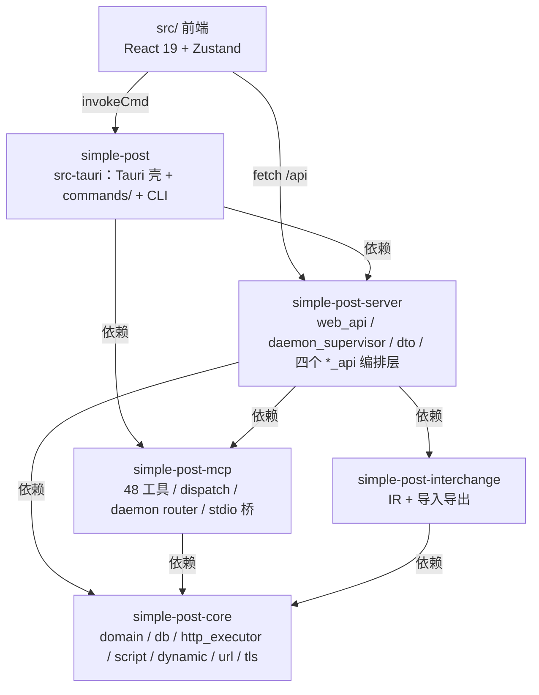

> 适用范围：要改任何一侧代码的人，动手前先确认依赖方向与哪些地方必须一起改
> 权威来源：AGENTS.md §Architecture & Data Flow、crates/simple-post-server/README.md、crates/simple-post-interchange/README.md、src-tauri/Cargo.toml、src-tauri/src/lib.rs、src-tauri/src/commands/mod.rs
> 最后核对：2026-11-13（v0.1.34）
> 前置阅读：01-overview.md

# 02 架构

## 一句话结论

依赖是**单向的一条链**：`simple-post (Tauri) → simple-post-server → simple-post-core`。`interchange` 与 `mcp` 都只被 server 依赖、都只向下依赖 `core`，没有任何反向边；拆分的目的只有一个——让容器镜像与 `--lib` 测试二进制不链接 GTK/WebKit。由此派生出的最大约束是**双传输不变量**：一条后端命令要在五个地方同时存在，漏一处只会坏掉其中一种形态，而且不报错。

## 结构：crate 与依赖

| crate | 一句话职责 | 不依赖什么 |
| --- | --- | --- |
| `simple-post-core` | 领域模型、SQLite、出站 HTTP、脚本沙箱、动态变量、TLS、URL 规则 | Tauri、axum |
| `simple-post-server` | REST + SPA 宿主、daemon supervisor、端口登记、bearer 鉴权、线格式 DTO、两个传输共享的编排层 | 默认不依赖 Tauri（`gui` feature 才挂） |
| `simple-post-interchange` | 外来格式 ↔ IR ↔ `domain`，含诊断与指纹去重 | Tauri、axum；`core` 不知道 Postman/OpenAPI 存在 |
| `simple-post-mcp` | JSON-RPC 派发、工具注册表、能力门、`variable_fill` 解析、stdio 桥 | 刻意**不依赖** interchange |
| `simple-post`（src-tauri） | 桌面 GUI、`#[tauri::command]` 面、CLI 四分支 | — |

**为什么 `simple-post-mcp` 不依赖 `interchange`**：MCP 的 scope 里没有任何导入导出工具。独立成 crate 就是为了让桥接二进制不必背上 YAML 解析器与两套外来格式模型（`crates/simple-post-interchange/README.md` 开头即写明）。如果哪天要给 AI 一个「导入 Postman」的工具，那是一次**体积与依赖方向的决策**，不是顺手加一行 use。

**为什么 `gui` feature 默认关闭**：`crates/simple-post-server/Cargo.toml` 的 `gui = ["dep:tauri"]` 只重新挂上三个吃 `AppHandle` 的 daemon 动词（`ensure_started` / `start` / `restart`），作用是把 `daemon://crashed` 事件送回 webview。`src-tauri` 打开它，Docker 镜像不开。**不要为了「多共享点代码」把它挪进 default**——那正是这个 feature 存在的理由。

**wire DTO 的归属**：两端都要用的形状（`McpStatusDto`、`CreateEndpointDetailOpts`、`RestartResult` 等）定义在 `crates/simple-post-server/src/dto.rs`。`src-tauri/src/commands/dto.rs` 只有一行 `pub use simple_post_server::dto::*;`，是兼容面不是定义处。把 DTO 搬回 `commands/` 会让 server crate 重新耦合 `tauri::State`，镜像也就重新需要 Tauri。

## 结构：双传输

同一句用户动作在桌面走 Tauri IPC，在浏览器走 REST。两侧**共享**业务实现，只有薄壳不同：薄壳负责线格式（解析 JSON、补 id、把字符串解析成枚举），编排住在 server crate 的 `project_api.rs` / `interchange_api.rs` / `spec_api.rs` / `dynamic_api.rs`。

**新增一条后端命令 = 五处协同编辑**（`AGENTS.md §Dual-transport invariant`）：

1. `src-tauri/src/commands/<resource>.rs` 里的 `#[tauri::command]` handler；
2. `src-tauri/src/commands/mod.rs` 用**glob** `pub use <resource>::*;` 导出；
3. `src-tauri/src/lib.rs` 的 `tauri::generate_handler![…]` 注册（`lib.rs:156` 起）；
4. `src/lib/tauri-commands/commands.ts` 的 `COMMANDS` 条目（camelCase 键 → snake_case 值）；
5. `crates/simple-post-server/src/web_api/routes/<resource>.rs` 的 handler + `web_api/router.rs::build_router` 的 `.route()` 注册（`router.rs:65`），浏览器可调时再加 `src/lib/tauri-commands/web-routes.ts` 的 `WEB_ROUTES` 条目。

当前两侧是对齐的：`COMMANDS` 与 `WEB_ROUTES` 各 **59** 条。`WEB_ROUTES` 缺条目不等于坏掉——`webInvokeCmd` 会显式抛出「该命令未在 web 形态暴露」；坏的是**你忘了加**，于是浏览器形态在你没测的那条路径上抛错。

## 结构：请求装配的两条路径

- **渲染进程**组装「这一次发什么」：`src/lib/http-build/prepare.ts::prepareRequest`（唯一组装函数），因为草稿的未保存编辑只有它知道。
- **后端**组装「这个端点是什么」：`crates/simple-post-mcp/src/variable_fill/resolve.rs::resolve_endpoint` / `resolve_endpoint_with`（动态变量值先并进变量池），MCP 的 `api_call_endpoint` 与 `api_run_request` 共用它。

两条路径的**规则必须逐条相同**，而规则写了两处，所以由共享样本钉住：`fixtures/resolve-parity.json`（15 条，含路径改写→拼接→模板替换→斜杠收拢的次序）、`multipart-parity.json`、`body-parity.json`、`base-url-parity.json`、`oauth2-*.json`、`path-params-parity.json`、`dynamic-parity.json`、`collection-order-parity.json`、`placement-parity.json`。**改动任何一条规则就改两处**，否则样本红。唯一的例外是路径前缀改写本身：它的实现只有一处（`crates/simple-post-core/src/url.rs::apply_rewrite`），MCP 侧与导入导出侧都转发到它。

装配顺序与细节见 [04-request-pipeline.md](04-request-pipeline.md)；样本清单与读取器见 [08-interchange-and-parity.md](08-interchange-and-parity.md)。

## 结构：前端首屏分包红线

- **`lazy()` 一切重壳**：`src/App.tsx:33-56` 对 `WorkspaceShell` / `SettingsSurface` / `BootstrapErrorBanner` / `CreateProjectDialog` 全部 `lazy()`；`WorkspaceShell.tsx:30,35` 再对 `ResponseViewer` / `SettingsPanel` 懒加载。CodeMirror 因此不在冷启动块里。
- **`manualChunks` 必须是函数**：Vite 8 跑在 Rolldown 上，兼容层不转换对象形式的 `manualChunks`，会直接报 `Expected Function but received Object`（`vite.config.ts:71`）。而且 CodeMirror 与 `marked` **不得**出现在任何静态入口可达的块里——列进 `manualChunks` 会被提升成一个块并发出**静态** import，编辑器又回到关键路径。
- **GSAP 不在关键路径**：`src/lib/gsap.ts` 一被入口触达就多付约 60KB。欢迎页入场动画用 CSS（`.welcome-enter`），对话框/横幅按需挂载而非无条件渲染——`lazy()` 在**渲染**瞬间就发 import，光包 `<Suspense>` 挡不住首帧下载。

## 不变量（改动会破什么）

- **依赖方向不能出现反向边**：`core` 里 `use simple_post_server` 或 `server` 里 `use tauri` 都会让镜像重新背上 GUI 栈；`mcp → interchange` 会让桥接二进制多一个 YAML 解析器。
- **编排层只写一次**：任何「取内容 → 折形状 → 落库」的逻辑放进 server crate 的 `*_api`，两侧薄壳只做线格式。写在某一侧，另一侧会静默少一半功能。
- **`commands/mod.rs` 必须是 glob `pub use`**：列条目会把 `#[tauri::command]` 生成的 `__cmd__<name>` 宏留在子模块，`generate_handler!` 解析不到，编译报 E0433。
- **DTO 只定义在 `server::dto`**；`src-tauri/src/commands/dto.rs` 保持转发。
- **`manualChunks` 保持函数形式**；CodeMirror/`marked` 不进任何静态入口块。

## 陷阱

- **`#[tauri::command]` 的参数按名绑定，不会反序列化 payload。** 宏把每个参数名过一遍 `to_lower_camel_case` 得到 payload 键。写成 `opts: ImportPreviewOpts` 能编译、Rust 测试全绿、web 形态完美，然后**每一次**桌面调用都失败在 `invalid args … missing required key opts`。参数列表必须逐字段摊平，正好等于 REST body 的字段集。回归网：`src-tauri/src/commands/interchange_test.rs`（比对源码形状、渲染层键与 serde 视图）与 `web_api/routes/interchange_test.rs`（真实请求）。
- **`Tauri 2` 的 `invoke` 不接受 `AbortSignal`。** `invokeCmd` 在 Tauri 分支直接把它丢掉（`src/lib/tauri-commands.ts`），所以「取消请求」在两端不是同一件事。
- **`/mcp` 不在 `serve-web` 的 router 上。** `web_api/router.rs` 文件头明确写着这里没有 MCP 路由；MCP 是守护进程自己的监听端口。给主端口加一条 `/mcp` 会造出第二个入口。
- **spec 的「两个宿主」不是双传输不变量。** spec 只有 REST 与 MCP 两个宿主、没有桌面调用点，所以只有两处壳；给 spec 加一条 Tauri 命令是错的。
- **`http_request` 必须保持非 `pub`**：`#[tauri::command]` 与 `generate_handler!` 都会生成同名内部宏，`pub` 时在 crate 根撞名（E0255）。

## 相关笔记

- [03-data-model.md](03-data-model.md) — 表结构与 domain 类型
- [04-request-pipeline.md](04-request-pipeline.md) — 两条装配路径的逐步次序
- [05-mcp.md](05-mcp.md) — 工具表、能力门、daemon 端口
- [07-frontend.md](07-frontend.md) — 切片、surface、分包
- [08-interchange-and-parity.md](08-interchange-and-parity.md) — fixtures 与读取器
- [10-glossary.md](10-glossary.md) — dual-transport / DTO / IR

## 文档与实现不一致

- `src-tauri/src/main.rs` 里同一个 `mcp-proxy` 子命令的两段注释指向了不同的二进制名：`:33` 说「use the separate `simple-post-mcp-proxy` binary for stdio mode」，`:81` 说「This is a separate binary (`simple-post-mcp.exe`)」。实际存在的是 `simple-post-mcp`（`crates/simple-post-mcp/Cargo.toml` 的 `[[bin]]`），`simple-post-mcp-proxy` 是已删除的旧名（`src-tauri/Cargo.toml:14` 也这么说）。以 crates 清单为准。
