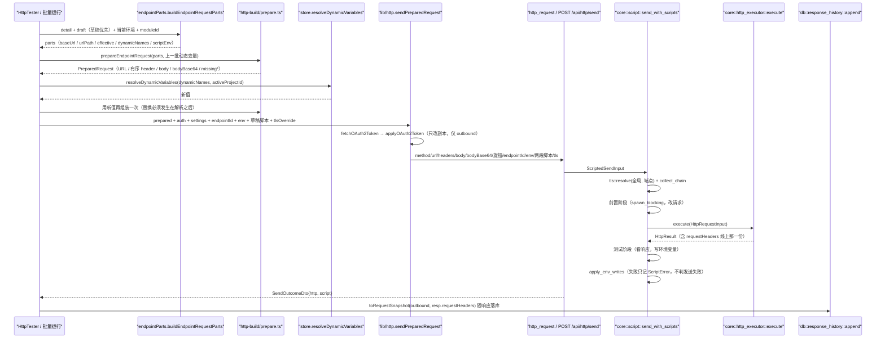

> 适用范围：改请求组装、body/multipart、鉴权注入、脚本插入点、请求历史的人
> 权威来源：AGENTS.md §HTTP execution / §Scripts、`src/lib/http-build/prepare.ts`、`crates/simple-post-core/src/script/send.rs`、`crates/simple-post-core/src/http_executor.rs`、`crates/simple-post-mcp/src/variable_fill/resolve.rs`
> 最后核对：2026-11-13（v0.1.34）
> 前置阅读：01-overview.md、02-architecture.md

# 04 请求链路：从草稿到落历史

## 一句话结论

线上请求只由**一个纯函数**造出来——渲染进程是 `prepareRequest`，MCP/REST 是 `resolve_endpoint_with`——然后两侧都进同一条序列 `core::script::send_with_scripts`（前置脚本 → 发送 → 测试脚本 → 变量回写）。桌面与 MCP 的差别只在「谁组装」和「带不带界面草稿」，**脚本插在哪一步**没有第二份实现。

## 链路

MCP 分支更短，但汇入同一点：`api_call_endpoint` / `api_run_request` / `api_run_collection` → `variable_fill::resolve_endpoint_with` → `http_ops::send::execute_resolved`（OAuth2 注入、multipart 装配）→ `send_with_scripts` → `record_history`。三条发送工具共用 `execute_resolved`，只是结果封装的形状不同。

## 不变量

1. **组装一次，预览与发送同源。** `HttpTester.tsx` 的 `prepared` 是 `useMemo`，cURL 预览与真实发送读同一个对象；`sendPreparedRequest` 只做 OAuth2 注入，且返回新对象（`applyOAuth2Token` 不改入参），否则预览会多出一条 `Authorization`。token 只在 `outbound` 里，绝不进 cURL。

2. **`content` 是载荷，`schema` 是定义。** `resolveBody` / `prepareRequest` 只读 `body.content`；`schema` 从不上线（`src/features/http-tester/__tests__/body-schema.test.ts` 钉住）。拒收门是 `core::spec::input::reject_schema_shaped_payload`：`mode == json` 且顶层同时有 `type`+`properties`（或出现 `$schema`）、且 `schema` 为空 → 报 `Validation` 并点名 `body_schema`。填了 `schema` 就不拦（那是有意为之）。调用点：`spec/upsert/write.rs`、`project_ops/endpoint/write.rs`、`variable_fill.rs`（`api_validate_endpoint` 只报 issue）。**桌面保存路径没有这道门**。

3. **七种 `body_mode`**（`domain::BodyMode`，`core/body.rs` 顶部表格即权威）：

   | mode | `content` 装什么 | 模板化 | 产物 |
   |---|---|---|---|
   | `none` | 空 | — | 无 body |
   | `json` / `xml` / `raw` | 原文 | 整段 | 文本 |
   | `form` | 行数组 JSON 文本 | 逐字段 | urlencoded 文本 |
   | `multipart` | 分片数组 JSON 文本 | 逐字段（文件分片除外） | 字节，在**发送侧**装配 |
   | `binary` | 文件描述 JSON 文本 | 不模板化 | 文件字节 |

   `form` / `multipart` 是结构化的：整段替换会把值里的引号变成坏 JSON，故逐字段。`form` 的空键行不进正文也不报缺值；旧格式（拼好的 urlencoded 串）按 `parse_legacy_form_fields` 兼容读取。

4. **`body` 与 `bodyBase64` 互斥。** 二进制请求体（`binary` 模式、带文件分片的 multipart、非 UTF-8 字节）走 `bodyBase64`；后端 `request_body_bytes` 里 `body_base64` **优先于** `body`，解不开 base64 是错误而不是发空 body。响应侧 `split_response_payload` 的判据顺序是**先 Content-Type、后字节有效性**：`is_textual_content_type(ct) || from_utf8(raw).is_ok()` → 文本，否则 base64；`size_bytes` 与截断都按上限算。

5. **URL 组装的顺序不可调换**（`prepare.ts` 注释逐条给出理由）：改写在最前（只作用端点自己的 path）→ join baseUrl → 替换 `{路径参数}`（值先解析 `{{var}}` 再编码，残留 `{{` 就按未填处理）→ 解析 `{{var}}` → 折叠重复斜杠（必须**在替换之后**）→ 追加 query（编码）→ 追加 query 位置的 apikey。

6. **规则双写由 fixtures 钉住。** `prepareRequest` 与 `resolve_endpoint_with` 是同一套规则的两份实现，跨语言样本逐个对手：`resolve-parity.json`、`body-parity.json`、`multipart-parity.json`、`oauth2-parity.json`、`oauth2-config-parity.json`、`base-url-parity.json`、`path-params-parity.json`、`placement-parity.json`、`collection-order-parity.json`、`dynamic-parity.json`。改任何一侧而不同步另一侧 = 只坏一种形态，且测试会红在 parity 文件上。

7. **线上请求头 vs 历史快照。** `effective_request_headers`（`http_executor.rs`）在调用方的 header（名转小写、丢空名）之后补传输层必然存在的那几条：`accept: */*`、`accept-encoding: gzip,deflate,br`、`host`（默认端口不写）、`content-length`（按**字节数**，不是字符串长度）；调用方写过同名头就不补。它只进 `HttpResponse.request_headers`，**不**改写实际发出的请求。历史行 `StoredRequestSnapshot` 存的是**解析后**那一份（URL 已拼接替换、query 已追加），header 优先取 `request_headers`，请求没抵达时回落到界面上拼的那几条（`toRequestSnapshot` / `stored_request` 同一规则）。

8. **请求旋钮与 TLS 是两层。** 超时/重定向/体积住在 `preferences` 的 `request_settings` 行（值是 JSON 编码的 `RequestSettings`，三条写路径共用 `db::preferences::set` 的校验）；MCP 侧 `resolve_settings` 以这一行为起点再叠调用方覆盖。TLS 是 `core::tls::resolve(全局, 端点)`：端点给了一份就**整体**取代全局那份，不做逐字段合并（三态在存储上无法区分）。

9. **落单代理项先归一。** `prepareRequest` 入口 `wellFormedDeep` 把孤立代理项换成 U+FFFD，二进制模式的 `content` 例外（那份 base64 描述另行归一）。不归一时 `encodeURIComponent` 抛 `URIError`，异常直冲 React 根节点。

## 陷阱

- **`{{var}}` 的判空顺序。** 「有没有 body」看的是用户写的**原文**、在模板化之前（`resolve_body` 先 `content.is_empty()`）。先模板化再判空，会把「内容只有一个变量、解析成空串」的请求静默变成没有 body。
- **multipart 的 Content-Type 位置和其它模式不同。** 它在 header 阶段不补；装配 body 时若用户写过就**就地改值**（保留用户的大小写），没写过才追加到列表末尾。两侧都这样，改一侧就会出现「发得出去、服务端解析不出分片」。
- **`resolved.body_mode` 要读套过 overrides 的那份**（MCP `execute_resolved` 注释）：读端点行里存的 mode，会在 `overrides.body` 换掉 mode 时给出「没有 Content-Type」或「只剩收尾分隔符的壳」。
- **OAuth2 的 token 可能进历史。** query 档把 token 拼进 URL；`toRequestSnapshot(outbound)` 存的是注入后的 URL，故 `request_json.url` 里带着活凭据。响应列 `url` 在桌面侧刻意报注入前那份（`invokeAndMap(..., request.url, ...)`），MCP 侧 `resp.url` 是注入后的——同一张表两种口径。
- **路径参数缺值不发。** `missingPathParams` 非空即停（渲染层 `onPathParamGate`，MCP `blocked: true`），且这一步在动态变量解析**之后**：路径参数的值本身可能就是动态变量。
- **脚本失败不改写发送成败。** 脚本抛错 → 那一阶段对请求的改动回滚、该段环境写回丢弃，但 `HttpResult` 原样返回；写回数据库失败也只折成一条 `ScriptError`（`send.rs::send_with_scripts`）。

## 文档与实现不一致

- `crates/simple-post-mcp/src/mcp/resources.rs` 的 `endpointTemplate.body_mode` 写成 `none | json | form | multipart | raw`（5 个），而 `guide.rules` 同一份资源里正确列出 7 个（多 `xml` / `binary`），`spec::input::BODY_MODE_VALUES` 也是 7 个。照着 `endpointTemplate` 填 `xml` 的 agent 会以为不支持。
- `AGENTS.md §HTTP execution` 与实现一致；但桌面侧没有 `content`/`schema` 的拒收门，只有 MCP/REST 写入路径有，文档未点明这层不对称。

## 相关笔记

- [03-data-model.md](03-data-model.md) — `endpoint_details` / `response_history` 的列与级联
- [05-mcp.md](05-mcp.md) — MCP 侧同一条链路的入口与权限门
- [06-dynamic-and-scripts.md](06-dynamic-and-scripts.md) — 变量池合并、脚本沙箱细节
- [08-interchange-and-parity.md](08-interchange-and-parity.md) — `fixtures/*-parity.json` 的通用机制
