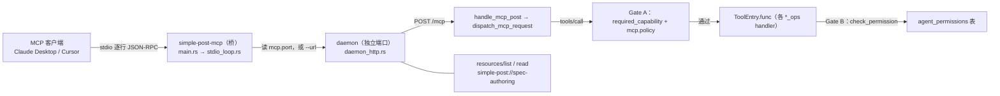

> 适用范围：加/改 MCP 工具、动工具注册表与能力门、改守护进程端口与资源指南的人
> 权威来源：AGENTS.md §MCP server、`crates/simple-post-mcp/src/mcp/{registry,dispatch,protocol,permissions}.rs`、`crates/simple-post-mcp/src/daemon_http.rs`、`crates/simple-post-core/src/port_file.rs`、`crates/simple-post-server/src/daemon_supervisor.rs`
> 最后核对：2026-11-13（v0.1.34）
> 前置阅读：01-overview.md、02-architecture.md

# 05 MCP 形态

## 一句话结论

`simple-post-mcp` 是**桥**，不是服务：它把 stdin 上的 JSON-RPC 逐行转发给运行中的 daemon（或在 `--transport=http` 下自己开一个小 axum），真正的裁决在 daemon 的 `mcp::dispatch`。工具总数实测 **48**，注册表 `tool_table()` 与能力表 `REQUIRED_CAPABILITY` 必须**双射**；两道门（全局能力档、逐项目权限）任一漏配都是 fail-closed 的拒绝，不是放行。

## 结构

- 桥的三种形态（`main.rs`）：默认 stdio；`--url` 指定地址；`--transport=http --port 4333` 自己起 axum 转发同一个 `WebClient`。没给 `--url` 时 `port_file::read_port()` 从 `mcp.port` 取端口——**主端口不提供 MCP**，拿它当默认只会连到 SPA 壳。
- `tools/list` 在桥上还会被 `capability::filter_tools` 本地收窄一次（`--capability` / `SIMPLE_POST_MCP_CAPABILITY`）。这一层只收窄、不放宽，且**按名字后缀启发式**判定（`_create` / `_update` / `_delete` / `_set_` / `_move` / `_duplicate` + 显式列出的 `api_run_*`、`dynamic_var_resolve`），是第二份规则、只给「服务端已放开但仍不想让 AI 看见」的用户用。
- `initialize` 报 `protocolVersion: "2024-11-05"`，`capabilities.tools.listChanged=false`、`resources.subscribe=false`；`notifications/initialized`、`notifications/cancelled` 直接 204。
- 信封级失败走 JSON-RPC `error`（-32700 解析、-32600 `jsonrpc != "2.0"`、-32601 未知 method、-32602 缺 `params.name` / 未知 resource uri）；**工具级**失败走 `result.isError: true`，因为 LLM 必须读到正文才能恢复。

## 工具数量与两张表

实测（`tool_table()` 由六个 `table()` 拼成）：

| 来源 | 数量 |
|---|---|
| `env_ops` | 7 |
| `project_ops`（project 5 + module 5 + collection 5 + endpoint **9** + spec 1） | 25 |
| `http_ops` | 3 |
| `variable_fill` | 3 |
| `response_parse` | 3 |
| `dynamic_ops` | 7 |
| 合计 | **48** |

`REQUIRED_CAPABILITY` 也是 48 行，`mcp/mod_test.rs::registered_tool_count_matches_the_documented_figure` 把 `EXPECTED_TOOL_COUNT = 48` 钉死，`every_registered_tool_has_a_capability` 与反方向的 `every_capability_row_names_a_registered_tool` 保证双射。**加一个工具 = 同一个 commit 里改 `tool_table`（各 `*_ops::table()` + `REQUIRED_CAPABILITY` 一行），并更新这个常量与两份文档。**

`endpoint_*` 的 9 个是：`list` / `get` / `history` / `search` / `create` / `update` / `delete` / `duplicate` / `move`。

## 两道闸

**Gate A —— 全局能力档**（`preferences` 的 `mcp.policy`，线格式 `read_only` / `safe_write` / `full_access`，缺行 = `read_only`）。

- `tools/list` 侧：`registry::tool_descriptors` 按 `policy.satisfies(capability)` 过滤，未分类工具不出现。
- `tools/call` 侧：`dispatch` 先用 `tool_table()` 找 handler（未知名字回 `NotFound`，**先于**能力门，否则会被掩盖成 `PermissionDenied`），再 `required_capability(name)` + `resolve_capability(pool, None)`（此处无项目维度），缺行一律拒绝。
- 排序：`Read < Create < Update < Delete`，`Send` 与 `Delete` 同级但**只有 `full_access` 覆盖 `Send`**——`safe_write` 不覆盖任何外发 HTTP。

**Gate B —— 逐项目权限**（`agent_permissions`，`Read < ReadCall < Full`）。`mcp::permissions::check_permission` → `core::permissions::required_permission(tool)`：未知工具默认 `Full`；`api_run_request` / `api_call_endpoint` / `api_run_collection` / `dynamic_var_resolve` 是 `ReadCall`；只读工具显式列为 `Read`。**调用处必须 `?` 传播。**

两条**已知失效模式**，都靠源码级哨兵测试守住（行为测试抓不到——被永久拒绝的工具照样返回格式完好的 `PermissionDenied`）：

1. 传字面量 `"global"` 过门（`no_gate_is_passed_the_literal_global`）。`agent_permissions.project_id` 是指向 `projects(id)` 的外键，项目 id 是 `proj_<millis>`，`"global"` 永远查不到行 → 退回 `Permission::default() = ReadCall`，写工具被永久拒绝；按 `collection_id` / `module_id` 收窄时更糟：真实拥有者的权限一次都没读。现在 handler 一律用 `nodes::root_id_of` 解析真实归属，**无范围的跨项目读直接拒绝**（`endpoint_list` 即是）。
2. 丢弃 `check_permission` 的结果（`no_permission_check_result_is_discarded`）。对结果调 `.ok()` 会吞掉 `PermissionDenied`，门形同虚设。测试扫描同时含 `check_permission(` 与语句以 `.ok();` 结尾的文件。

## 守护进程与端口

- `mcp.port` 是平台数据目录下的一行 JSON（`PortRecord`：`pid` / `port` / `bind` / `data_dir` + 时间戳），core 的 `port_file` 同时被 server（写）与 mcp（读）使用，故路径规则只有一份。`read_port()` 不创建父目录。
- 收养还是换掉：`daemon_supervisor::ensure_started_with` 先看端口文件里那个 pid 活着且 `/mcp/healthz` 通，再比 `config_fingerprint`（`http_config.rs`：`host` / `port` / `path` / `allow_remote` / 排序后的白名单，带 `v: 1`）。一致 → **Adopt**（不杀不重拉，在途会话不断）；不一致或旧记录无指纹 → **Restart**。`ensure_started` 与 `ensure_started_with` 必须留在该文件里，源码级测试按文本扫描它们，且共享 spawn 路径不得出现 `AppHandle`（否则 `--lib` 测试二进制在加载时死于 comctl32 入口点）。
- `serve-web` 走同一判定：`start_without_app_handle(data_dir)` → `ensure_started_with` → `poll_only_finish`，只是不发 `daemon://crashed` 事件。桌面与容器的差别仅在「谁提供 data_dir」。
- 端口上有两层 HTTP 守卫：`daemon_http::host_origin_guard`（回环永远放行；`allow_remote=false` 时只认回环与配置的绑定 host；`Origin` 缺省放行 = AI 客户端），以及 server crate 的 `auth::auth_middleware`（同一口令，`/mcp/healthz` 与各挂载前缀的 `<mount>/healthz` 公开；空口令按「没有闸」处理）。挂载前缀恒为「配置里那个 + `/mcp` 别名」，别名是 `port_registry::healthz` 写死探 `/mcp/healthz` 的依赖。
- 容器：容器内端口固定由 `mcp.http_config.port` 决定（**应用设置是唯一真相**，`0` 表示 OS 分配、无从发布）；`docker/docker-compose.yml` 的 `target` 必须等于它，且 `监听地址` 要是 `0.0.0.0` 才通。host 模式发布端口属于任务本身，故 `docker/docker-swarm.yml` / `docker/docker-portainer.yml` 在你解开端口映射后必须把 `update_config.order` 从 `start-first` 改成 **`stop-first`**，否则旧任务占着宿主端口、新容器起来却没有那条映射。

## `tools/list` 的体积预算

`mcp/mod_test.rs::TOOLS_LIST_BUDGET_BYTES = 44_050`，量的是**紧凑序列化后的 UTF-8 字节**（与 axum `Json` 响应体一致），当前载荷 43 952 字节。token 数用真实分词器量（文档记 9_413 tokens）；测试里的 `len * 100 / 471` 只是估算（字符数 ÷ 3 会高估约六成）。报告的 ignored 测试把紧凑版与缩进版都写到 `target/`，**分词器只能量紧凑那份**。超限的做法是把长规则搬进 `simple-post://spec-authoring`，不是放宽预算。

## 资源：`simple-post://spec-authoring`

`resources.rs` 的 `guide()` 是**跨工具**的说明（一次调用形状、手动调用顺序、`endpoint_create` 全参数模板、响应里 `created` / `created_collections` / `missing` 的含义），刻意不塞进 48 条描述——它是按需读的。`resources/read` 认不出 uri 时回 `-32602`，而不是空 `contents`（空内容会被读成「这份资源是空的」）。`resources_test.rs` 是防过期网：指南点名的每个工具必须注册着，`endpointTemplate` 的每个键必须在 `endpoint_create` 的 schema 里，`spec_upsert` 的嵌套键也要能对上。

## `spec_upsert` 的六条规则与 `if_exists` 四值

编排在 `core::spec::upsert`（不在 MCP handler 里），REST `POST /api/spec/upsert` 与工具共用：

1. **一个事务**：模块、路径上的集合、环境、端点全落或全不落（半份规格不许留下无端点的模块）。
2. **容器类按名字「找或建」**：模块、集合、环境永远复用，没有冲突可言。
3. **端点按「同一父下 name + method + url」判身份**：端点名字不唯一（两个集合下各有一个「查询」是常事）。
4. **`if_exists` 只管端点**：`reuse`（缺省，一个字段都不写）/ `error` / `duplicate` / `update`（只覆盖规格点名的字段；name、verb、path 是身份，永不变）。注意 `IfExists` 有 3 值，`EndpointIfExists` 才有第 4 个 `update`。
5. **环境段总是落库**：变量**合并**进已有变量（不替换整张表），`baseUrl` 写进 (环境 × 模块) 那一格；与端点的 `if_exists` 无关。
6. **不建项目、不动权限档位**：`db::projects::get` 查不到即 `NotFound`。逐项目权限门**只有 MCP 工具**过，REST 路由不过（AGENTS.md 明写）。

## 线格式硬约束

- **camelCase 三条输出路径**：`ToolDescriptor`（`inputSchema`，48 条逐一断言）、`CallToolResult`（`isError`，成功时**省略**该键）、`daemon_http::handle_tools_call` 失败分支的 `json!` 手写字面量（绕开了 serde 属性，`daemon_http_error_arm_types_the_spec_spelling` 源码扫描 `"isError": true`）。写成 snake_case 的症状是合规客户端静默忽略——功能测试全绿。
- **`preferences.value` 是 JSON 编码值**：`db::preferences::set` 做 `serde_json::to_string`，`get` 做 `from_str`。手工写入裸对象（`mcp.http_config`）在读取时解析失败并被报成错误，而不是静默退回默认（那会把一个局域网可达的 daemon 降级成 only-loopback）。

## 不变量

1. `tool_table()` 与 `REQUIRED_CAPABILITY` **双射**，且数量 = 48（常量 + 三份文档一起改）。
2. 两道门的缺省方向都是**拒绝**：Gate A 缺行拒、Gate B 未知工具按 `Full` 要求。
3. `tools/list` 与 `tools/call` 用**同一套**策略解析，故不复查清单直接调用的客户端也改不动任何东西。
4. 线格式 camelCase：`inputSchema` / `isError`，三条输出路径都要对。
5. `preferences.value` 一律 JSON 编码；解析失败是错误，不是「退回默认」。
6. 收养优先：指纹一致就 Adopt，不杀不重拉；只有不一致才 Restart。
7. 挂载前缀恒含 `/mcp` 别名；守护进程端口与 `auth_middleware` 同口令。

## 陷阱

- 能力门缺行 = **拒绝**，不是隐式放行；`REQUIRED_CAPABILITY` 与 `tool_table()` 少一边就会被两张哨兵测试之一抓住。
- `dispatch` 先解析 handler 再过门：顺序反了，未注册工具会以 `PermissionDenied` 出现，LLM 找不到「你拼错了工具名」这条信息。
- 本地 `--capability` 过滤按**名字后缀**推断，和后端 `REQUIRED_CAPABILITY` 是两份规则。新工具若不带那六个后缀又确实会写/发，必须同时改 `capability.rs` 的显式清单，否则 `read_only` 档下它会漏进清单。
- `McpHttpConfig` 的路径可改，但 `/mcp` 别名永远在，改动前先看 `mounted_prefixes` 与 `port_registry::healthz`。

## 文档与实现不一致

- **工具数**：`AGENTS.md:5` 与 `:19` 写 48，`:420` 写「the 47-tool registry」——**47 是旧数**。实测 `tool_table().len() == 48`，`mod_test.rs::EXPECTED_TOOL_COUNT = 48` 断言通过；`README.md` 四处均为 48。
- `crates/simple-post-mcp/src/mcp/project_ops/mod.rs:53` 的注释写「projects (5) → … → endpoints (8) → spec (1)」「全部 24 条」，实际 `endpoint::register` 推 9 条、合计 25 条。数字注释未随 `endpoint_history` 一起更新。
- `crates/simple-post-core/src/db/preferences.rs`：`keys::MCP_AUTO_START` 的文档写「**默认 `false`**」，同文件 `mcp_auto_start()` 的注释与实现（`unwrap_or(true)`）都默认**开**。实现与后者一致，前者是旧说法。

## 相关笔记

- [02-architecture.md](02-architecture.md) — 依赖方向与双传输不变量
- [04-request-pipeline.md](04-request-pipeline.md) — 三个发送工具汇入的那条链路
- [06-dynamic-and-scripts.md](06-dynamic-and-scripts.md) — `dynamic_var_*` 七个工具与跨项目取值
- [08-interchange-and-parity.md](08-interchange-and-parity.md) — parity fixtures 的机制
