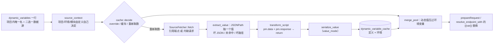

> 适用范围：改动态变量取数/缓存/合并、改请求脚本沙箱、改脚本链顺序的人
> 权威来源：AGENTS.md §Dynamic variables / §Scripts、`crates/simple-post-core/src/dynamic/*`、`crates/simple-post-core/src/script/*`、`crates/simple-post-mcp/src/mcp/dynamic_ops.rs`
> 最后核对：2026-11-13（v0.1.34）
> 前置阅读：01-overview.md、02-architecture.md

# 06 动态变量与请求脚本

## 一句话结论

两者都是**旁路增强**，都不能让一次发送失败：动态变量取不到值就按缺失处理（`{{name}}` 原样留着），脚本抛错就回滚它那一段、丢弃它的环境写回，请求照发。动态变量的值**必须在替换之前**并进变量池，脚本**必须在请求装配之后**插入——这两条是整篇的骨架。

## 结构：动态变量

**定义**（`domain::DynamicVariable`，表结构见 `db/schema.sql:263` 起）：挂在**项目**里，名字必须匹配 `^[A-Za-z0-9_]+$`（与 `template` 的 `{{name}}` 判据同一套）且项目内唯一。唯一性是**两条 partial unique index**：`(project_id, name) WHERE project_id IS NOT NULL` 与 `(name) WHERE project_id IS NULL`——SQLite 的多列唯一索引把多行 NULL 视为互不相同，未归属的行必须另有一条索引管。重名在写入处报 `Validation`（`db/dynamic_variables/write.rs`），不靠数据库错误泄露。

**数据源二选一，且必须有一个**：`source_endpoint_id`（复用那个端点自己的 base URL、鉴权、前置脚本）或 `source_inline_json`（method/url/headers/body/auth，URL 必须完整）。两者都空或都有 → `Validation`。`source_endpoint_id` 是 `ON DELETE SET NULL`：数据源端点被删时定义留下、这一列变 NULL；再保存时被上面那条「必须有一个数据源」拒绝——所以界面上「两个都空」**只可能**意味着「数据源已删除」，这两种状态因此可区分。`source_environment_id` 也必须属于数据源端点所在项目（`check_source_bindings`），否则报 `Validation`。

**取数上下文只由定义决定**（`dynamic::source_context`）：项目与模块来自数据源端点（`nodes::root_id_of` / `module_id_of`），环境是点名的那个、否则该项目**第一个**可用环境（按名字排序）；内联请求没有项目也没有环境。故同一个 `{{name}}` 在任何消费方那里取到的值都一样——分项目只是让不同项目可以有同名定义。

**抽取**（`extract::extract_value`）：响应体必须能解析成 JSON（否则 `NotJson`），`extract_path` 空/缺省按 `$`，路径非法是 `SourceError`（定义坏了，不是数据问题），没命中是 `NoMatch`。只取第一个命中节点。

**加工**（`transform::apply`）：脚本拿 `pm.data`（抽出来的值）、`pm.response`（原始响应）、`pm.environment`（取数用的环境），**`return` 的值就是最终值**；没有 `return`（`undefined`）算失败；没有脚本或全空白则原样通过。失败折成 `DynamicErrorKind::ScriptError`，与取数失败同等对待。

**缓存**：一行 = 一个「定义 × 取数环境」（唯一索引 `idx_dynamic_cache_key`），存在 SQLite 而不是进程内存——桌面、`serve-web`、MCP daemon 是三个进程，只放内存会各看各的。`decide` 的完整表在 `dynamic/cache.rs`：`force` 跳过一切（包括手工覆盖值）、覆盖值未过期用覆盖值、无覆盖值且缓存未过期用缓存、其余重新取数并把过期值留作回退候选。取数是单飞（`flight_lock` 按 (定义, 环境)），拿到锁后**再查一次缓存**。

**降级顺序**：覆盖值 → 新鲜缓存 → 取数 → 失败时过期缓存（仅 `stale_fallback`）→ 按缺失处理。失败**不阻断发送**：`{{name}}` 原样留在请求里，错误另记一条进 `DynamicResolution.errors`；返回值超过 `MAX_VALUE_BYTES`（256 KiB）记错误而不是塞进缓存表。

**合并规则**（`dynamic/merge.rs` 的 `merge_pool`，TS 侧 `src/lib/dynamic-vars.ts` 的同名函数，由 `fixtures/dynamic-parity.json` 钉住）：先取环境变量并去掉停用的，再**最后**并入动态值。用这两个顺序同时实现两条子规则——动态值压过同名环境变量；被停用的环境变量不影响动态值（停用过滤只作用于环境变量）。

**跨项目授权两处**（`mcp/dynamic_ops.rs`）：`dynamic_var_*` 的写工具既要过**归属项目**（谁拥有这条定义），也要过**数据源接口所属项目**（取数会真的用那个项目的 base URL 与凭据）。`dynamic_var_update` 还要检查 **patch 之后的**归属项目与数据源项目——只查旧的，等于给「把数据源搬走」留了一条不经门的路。数据源是内联请求时没有第二个项目可落。

**跨项目取值的歧义**：`resolve_names(project_id: None)` 是跨项目模式（`dynamic_var_resolve` 不点名项目时），同名定义出现在多个项目里记 `DynamicErrorKind::Ambiguous` 并按缺失处理，**不猜**。请求发送这条路永远带 `project_id`（消费方项目），故不会歧义。

**渲染层的桶**：`dynamicValues[projectId][name]`（`src/stores/dynamic-slice.ts`）。同一条定义只在一个取数环境上取值，故不按环境分桶；但必须按项目分桶，否则切项目时上一个项目的同名值会被读到。前端只做两件事——`mergePool` 与「请求模板引用了哪些名字」的扫描；取数、抽取、序列化都在 Rust。

## 结构：请求脚本

`send_with_scripts` 的固定次序（一条直链，故不另画图）：

1. `tls::resolve(&settings.tls, tls_override)` —— 端点给了一份就整体取代全局；
2. `collect_chain(endpoint_id, script_override)` —— 最外层 collection → 嵌套 collection → 端点；
3. **前置阶段**：`spawn_blocking` 里建一个 `Sandbox`，整条链共享它顺序执行，改写请求；
4. `http_executor::execute` —— 发的是脚本改写后的请求；
5. **测试阶段**：同一条链同序，先把前置阶段的环境写并进快照（Postman 语义：测试脚本要读得到前置写下的 token），再看响应；
6. `apply_env_writes` —— 一次事务落库（唯一持久化路径），失败只记 `ScriptError`。

下面每条都是「改它 / 绕它会破什么」：

- **唯一实现是 `core::script::send_with_scripts`**：桌面 `http_request` 命令、`serve-web` 的 `POST /api/http/send`、MCP 的 `execute_resolved` 三处都调它。若由调用方编排顺序，就会出现第二份「脚本插在哪一步」的实现，那正是这条链路存在的理由。（`serve-web` 刻意**不**注册节点级的 `/send`：那会是第二条不受出站策略统辖的出站通道。）
- **链顺序**：`collect_chain` 沿 `parent_id` 上溯（`seen` 防用户拖出来的环），只收 collection 的脚本（模块没有），反转成「最外层 → 内层」，最后推端点自己那一段。**前置与测试两个阶段同序**——Postman 官方文档如此，别按第三方说法把 test 反过来。
- **沙箱约束**（`script/engine.rs` 顶部三条禁令）：这里**不得 `panic!`**（release 是 `panic = "abort"`，脚本路径上 panic 会直接干掉替别人握着连接的 daemon）；这里**不得写 stdout**（`simple-post-mcp` 的 stdout 只有 JSON-RPC 帧）；引擎实例不跨线程（`Runtime` / `Context` 非 `Send`），故整条链在一个 `spawn_blocking` 里跑完。宿主**不注册任何 Rust 回调**：能力 = 固定前导 `PRELUDE` + QuickJS 标准库（无 I/O），故「够不到文件系统/网络/进程」不靠逐个禁用而靠没有那条路。进出只有一个 JSON 通道（`__SP_INIT__` / `__SP_DRAIN__`）。
- **资源上限**（`script/limits.rs` 的 `DEFAULT_SCRIPT_LIMITS`）：墙钟 1000 ms、内存 32 MiB、栈 256 KiB、日志 500 条、断言 200 条。预算**按阶段**（整条链共享一个 Runtime 与一个截止时刻）；超时靠 `set_interrupt_handler` 返回 `true` 抛**不可捕获**异常，故死循环真会被打断。内存上限只有不使用自定义分配器时才有效——本项目 `rquickjs` 是 `default-features = false, features = ["std"]`，**不开 `rust-alloc`**，改它会让 `set_memory_limit` 变成 no-op。
- **原子性**（`script/run.rs`）：一段脚本失败 → 它**对请求的改动被丢弃**（`effects.request` 已是回滚后的形状），它的环境写回也丢弃；日志与断言作为诊断**保留**；链条继续跑下一段。全部失败都不会让请求本身失败——脚本崩溃不是发送崩溃。引擎 panic 由 `spawn_blocking` 的 `JoinError` 接住，折成一条 `runtime` 错误。
- **发送时携带草稿脚本**：`ScriptOverride { pre_request, test }` **逐字段**覆盖端点存的那份（`None` = 用存的，`Some("")` = 没有脚本）。渲染层送的是界面上此刻生效的那份，否则「改完脚本没保存就发送」跑的是旧脚本。草稿接口没有集合链（没有落库的行），但它自己那两段脚本照样跑——`send_with_scripts` 在 `endpoint_id == None` 且带 override 时合成一个端点单元。
- **写回失败不判发送失败**：`apply_env_writes` 在一个事务里读当前变量表、`merge_env` 合并、整表写回；失败只清空 `env_writes` 并追加一条 `phase = Test` 的 `ScriptError`。没有环境可写（`env.id == None`）时写入被丢弃且不报错。

## 不变量

1. 动态值**在替换之前**并池；合并规则只此一处（`merge_pool`，两侧同源、fixtures 钉住）。
2. 取数上下文只由**定义**决定（项目/环境/模块），与谁消费无关。
3. 缓存键 = 定义 × 取数环境，落在 SQLite（三个进程共享）。
4. 取数与脚本的失败都**不**升格为发送失败；`{{name}}` 按缺失留在请求里。
5. 脚本只有一条实现（`send_with_scripts`），前置与测试两个阶段**同向**（collection → 端点）。
6. 单段脚本失败 → 请求改动与环境写回丢弃、日志断言保留、链条继续。
7. 沙箱预算按**阶段**给（1000 ms / 32 MiB / 256 KiB / 500 日志 / 200 断言），不跨阶段累计。

## 陷阱

- **取数上下文与消费方无关。** 有人会以为「在 A 项目里发请求，就应该用 A 项目的环境去取数」——不是。环境由定义决定（点名的，或数据源端点所属项目的第一个）。改这条会连带改缓存键的含义（`environment_id` 在键里，正是为了定义改环境后旧值还留着）。
- **`disabled` 只作用于环境变量。** 把动态变量当成「另一种环境变量」去想，很容易在停用名单里把它一起过滤掉。
- **`value_mode`**：`json` 给带引号的 JSON（标量也是 `"A001"`），`auto` 与 `text` 输出**完全一致**（对象/数组给裸 JSON，标量给纯文本）。`text` 是用户的声明而不是另一种序列化。
- **`force` 会跳过覆盖值，但开了 `stale_fallback` 时不会真的丢掉它。** 「刷新」按钮走 `force`：跳过缓存里的**一切**（含手工覆盖值）重新取数，这是刻意的（丢弃动作在界面上可见）。但 `decide` 仍把覆盖值作为 `stale_fallback` 候选传下去——取数失败时它按「过期值」返回，缓存行不会被替换（`cache.rs::stale_candidate` + `resolve.rs::fallback_or_missing`）。
- **数据源端点不能引用动态变量**（只用环境变量），故结构上不可能成环；新增取数路径时别破坏这条。
- **脚本改不动二进制请求体**：`ScriptRequest.body_base64` 存在，但脚本只改 `body`（文本形态）。
- 脚本链的断言/日志上限是**每阶段**共享的 500/200，不是每脚本一份。

## 文档与实现不一致

- `db/preferences.rs` 里 `MCP_AUTO_START` 的键注释与同文件的 `mcp_auto_start()` 注释互相矛盾（默认 `false` vs `true`），实现取 `true`。与动态变量无关，但常在同一次排查里读到。
- `dynamic/mod.rs` 说取数失败「退化顺序：覆盖值 → 过期缓存值（仅当 `stale_fallback`）→ 按缺失处理」，省略了「新鲜缓存」和「成功取数」两档；完整表在 `dynamic/cache.rs::decide` 的文档注释里。两处不矛盾，只是前者不完整。

## 相关笔记

- [04-request-pipeline.md](04-request-pipeline.md) — 合并后的池在哪里被消费
- [05-mcp.md](05-mcp.md) — `dynamic_var_*` 七个工具、两道门与 `Send` 能力
- [08-interchange-and-parity.md](08-interchange-and-parity.md) — `dynamic-parity.json` 的机制
